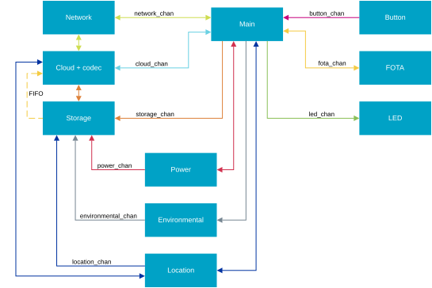
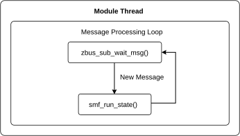
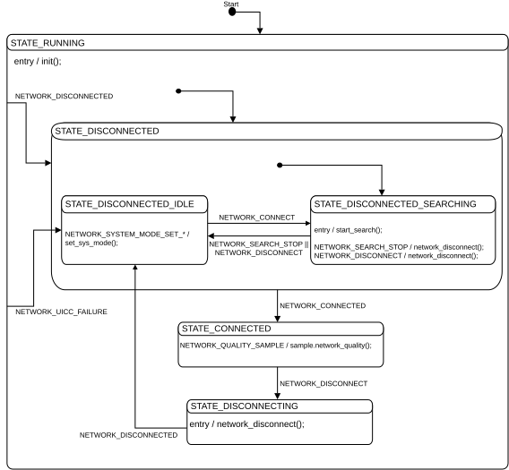

# Architecture

The Asset Tracker Template is built on a modular, event-driven architecture. The modules interact through messages that are processed as events by the modules' state machines.

The architecture is implemented using [Zephyr bus (zbus)](https://docs.nordicsemi.com/bundle/ncs-latest/page/zephyr/services/zbus/index.html) for inter-module communication and the [State Machine Framework (SMF)](https://docs.nordicsemi.com/bundle/ncs-latest/page/zephyr/services/smf/index.html) for managing module behavior.

This document provides an overview of the architecture, with a focus on the zbus message passing and the modules' state machines.

## System overview

The template consists of the following core modules:

- **[Main module](../modules/main.md)**: Implements the business logic and controls the overall application behavior.
- **[Storage module](../modules/storage.md)**: Stores data from enabled modules.
- **[Network module](../modules/network.md)**: Manages LTE connectivity and tracks network status.
- **[Cloud module](../modules/cloud.md)**: Handles communication with nRF Cloud using the Constrained Application Protocol (CoAP).
- **[Location module](../modules/location.md)**: Provides location services using Global Navigation Satellite System (GNSS), Wi-Fi, and cellular positioning.
- **[Button module](../modules/button.md)**: Reports button press events for user input.
- **[FOTA module](../modules/fota_module.md)**: Manages firmware over-the-air updates.

Unlike the other modules, the Main module is not in the `modules` folder.

The following modules are specific to the Thingy:91 X:

- **[Environmental module](../modules/environmental.md)**: Collects environmental sensor data (temperature, humidity, pressure).
- **[LED module](../modules/led.md)**: Controls an RGB LED for visual indication.
- **[Power module](../modules/power.md)**: Monitors battery status and provides power management.
- **[UART Power Control module](../modules/uart_power_control.md)**: Suspends and resumes the UART when VBUS changes.

The following diagram shows the system architecture and how the modules interact with each other. The modules communicate through zbus channels.



The following steps show the simplified flow of a typical operation:

1. The Main module schedules periodic triggers or responds to a short button press reported on the `button_chan` channel.
1. When triggered by timeout or button press, the Main module requests sampling in parallel from the Power, Environmental, and Location modules. It publishes the requests on `power_chan`, `environmental_chan`, and `location_chan`.
1. The Storage module buffers the sampled data. When the number of buffered records reaches `storage_threshold`, the Main module requests the buffered data from the Storage module, and the Cloud module sends it to nRF Cloud. You can configure the threshold at build time with `CONFIG_APP_STORAGE_INITIAL_THRESHOLD` or at runtime through the device shadow. See [Configuration](configuration.md#runtime-configurations).
1. Throughout the operation, the Main module controls the LED module over the `led_chan` channel to provide visual feedback about the system state.

## Module design

Each module follows a similar design:

- **Message channel**: Each module defines its own zbus channel. With some exceptions, a single channel is used for all messages that are specific to a module.
- **Message types**: Each module exposes a set of input and output message types. These can be considered events in the state machine sense and might have associated data.
- **State machine**: Most modules implement a state machine using SMF to manage their internal state and behavior.
- **Thread**: Most modules have dedicated threads.
- **Watchdog**: A task watchdog monitors each module thread. Each thread periodically calls `task_wdt_feed()` to feed its watchdog. If a thread fails to feed its watchdog within its configured timeout, the system resets.
- **Initialization**: Modules are initialized at system startup, either through `SYS_INIT()` or in their dedicated thread through `K_THREAD_DEFINE()`.

### Module interfaces

Modules in the Asset Tracker Template are designed as loosely coupled units with well-defined message-based interfaces.
Modules communicate exclusively through their defined zbus interfaces, without reference to other modules' internals. This design ensures that modules are self-contained and can be developed, tested, and maintained independently. Most modules, except the Main module, can also be reused in other applications.

Modules often handle state transitions based on messages they themselves publish. For example, the Network module publishes a `NETWORK_CONNECTED` message and also receives it in its own state machine. Receiving its own message lets the module transition to the connected state with consistent handling.

### Module threads

Most modules in the Asset Tracker Template have dedicated threads. If a module uses blocking calls while processing messages, a dedicated thread is required. For example, the Network module can react to a message by sending an AT command to the modem. The command can block until signaling with the network completes and the modem returns a response. Separate threads also help to keep the required stack size for each module more predictable.

Each module's thread follows a similar pattern: it waits for new messages and handles them by executing a state machine. The following diagram shows that pattern:



For example, a simplified version of the Network module's thread looks like this:

```c
static void network_module_thread(void)
{
        int err;
        static struct network_state_object network_state;

        /* Initialize the state machine to the initial state */
        smf_set_initial(SMF_CTX(&network_state), &states[STATE_RUNNING]);

        while (true) {
                /* Wait for a message on any subscribed channel */
                err = zbus_sub_wait_msg(&network, &network_state.chan,
                                        network_state.msg_buf, K_FOREVER);
                if (err == -ENOMSG) {
                        continue;
                } else if (err) {
                        LOG_ERR("zbus_sub_wait_msg, error: %d", err);
                        return;
                }

                /* Run the state machine with the received message */
                err = smf_run_state(SMF_CTX(&network_state));
                if (err) {
                        LOG_ERR("smf_run_state(), error: %d", err);
                        return;
                }
        }
}
```

In this pattern:

1. The thread waits for a message using `zbus_sub_wait_msg()`, which blocks until a message is received.
1. When a message arrives, it is stored in the state object's buffer along with the channel it was received on.
1. The state machine is then executed with `smf_run_state()`, which calls the appropriate handler for the current state.
1. The handler processes the message based on its type and the current state, potentially triggering state transitions.
1. The loop continues, waiting for the next message.

## Message passing with zbus

The zbus library is part of Zephyr and implements channel-based message passing between threads. This section covers how zbus is used in the Asset Tracker Template. See the [zbus documentation](https://docs.nordicsemi.com/bundle/ncs-latest/page/zephyr/services/zbus/index.html) for an introduction to zbus.

### Channels

In the Asset Tracker Template, each module declares and defines a channel using zbus macros. For example, in the `app/src/modules/network/network.h` file, the Network module declares the `network_chan` channel:

```c
/* Channels provided by this module */
ZBUS_CHAN_DECLARE(
	network_chan
);
```

The channel is defined in `app/src/modules/network/network.c`:

```c
/* Define channels provided by this module */
ZBUS_CHAN_DEFINE(network_chan, /* Channel name, derived from module name */
        struct network_msg,    /* Message data type */
        NULL,                  /* Optional validator function */
        NULL,                  /* Optional pointer to user data */
        ZBUS_OBSERVERS_EMPTY,  /* Initial observers */
        ZBUS_MSG_INIT(0)       /* Message initialization */
);
```

In the Asset Tracker Template, the fields of the `ZBUS_CHAN_DEFINE` macro are populated in a similar way across modules:

- **Channel name**: The name of the channel, derived from the module name.
- **Message data type**: The data type used to hold message data. The name comes from the channel name.
- **Validator function**: Not used.
- **User data**: Not used.
- **Initial observers**: The initial observer list is empty. Observers are added in the relevant modules later.
- **Message initialization**: The initial value stored in the channel. This field is not used, so it is set to `ZBUS_MSG_INIT(0)`.

> [!NOTE]
> In zbus, "message type" can refer to the data type or structure that holds the message data for a channel, in this case `struct network_msg`. In the Asset Tracker Template, "message type" means the enumerated value that distinguishes the kinds of messages sent on one channel, in this case the `type` field of `struct network_msg`.

### Message types and structure

Each module exposes a set of message types through an enumeration. The message types can be considered events in the state machine sense. The subscriber typically evaluates the message type in a switch-case statement. The statement determines what actions to take and whether to trigger a state transition.

The message types can be divided into two categories:

- **Input message types**: Commands or requests that other modules send to the defining module to trigger actions. For example, `NETWORK_CONNECT` asks the Network module to establish a network connection.
- **Output message types**: Responses or notifications that the defining module sends to other modules to report status, data, or events. For example, `NETWORK_CONNECTED` reports that a network connection has been established.

Each module's message types are defined in its public header file located at `app/src/modules/<module_name>/<module_name>.h`. For example, the Network module's messages are defined in `app/src/modules/network/network.h` in the `enum network_msg_type` enumeration:

```c
enum network_msg_type {
        /* Output message types */
        NETWORK_DISCONNECTED = 0x1,

        /* The device is connected to the network and has an IP address */
        NETWORK_CONNECTED,

        /* ... */

        /* Response message to a request for the current system mode. The current system mode is
         * found in the .system_mode field of the message.
         */
        NETWORK_SYSTEM_MODE_RESPONSE,

        /* ... */

        /* Input message types */

        /* Request to connect to the network, which includes searching for a suitable network
         * and attempting to attach to it if a usable cell is found.
         */
        NETWORK_CONNECT,

        /* Request to disconnect from the network */
        NETWORK_DISCONNECT,

        /* ... */

        /* Request to retrieve the current system mode. The response is sent as a
         * NETWORK_SYSTEM_MODE_RESPONSE message.
         */
        NETWORK_SYSTEM_MODE_REQUEST,
};
```

The message type forms the first part of the message structure. For some message types, associated data is present in the message. When the associated data varies based on the message type, a union is used to save memory. The message type determines which fields are valid. For optional features, `IF_ENABLED` macros are used to optionally include the fields.
The complete message structure for the Network module is also defined in `app/src/modules/network/network.h`:

```c
struct network_msg {
        enum network_msg_type type;
        union {
                /** Contains the currently configured system mode.
                 *  system_mode is set for NETWORK_SYSTEM_MODE_RESPONSE events
                 */
                enum lte_lc_system_mode system_mode;

                /** Contains the current PSM configuration.
                 *  psm_cfg is valid for NETWORK_PSM_PARAMS events.
                 */
                IF_ENABLED(CONFIG_LTE_LC_PSM_MODULE, (struct lte_lc_psm_cfg psm_cfg));

                /** Contains the current eDRX configuration.
                 *  edrx_cfg is valid for NETWORK_EDRX_PARAMS events.
                 */
                IF_ENABLED(CONFIG_LTE_LC_EDRX_MODULE, (struct lte_lc_edrx_cfg edrx_cfg));
        };
};
```

In this structure, a module receiving a `NETWORK_SYSTEM_MODE_RESPONSE` message can read the current system mode from the `system_mode` field.

### Message sending

Messages are sent on a channel using `zbus_chan_pub()`. The following example sends a message on the `network_chan` channel:

```c
        struct network_msg msg = {
                .type = NETWORK_DISCONNECT
        };

        err = zbus_chan_pub(&network_chan, &msg, PUB_TIMEOUT);
```

The zbus library copies the message, so the original message struct is no longer needed after calling `zbus_chan_pub()`.

### Message receiving

In zbus, structures called _observers_ receive messages on one or more zbus channels. The zbus library provides multiple types of observers, but the Asset Tracker Template uses only two: message subscribers and listeners.

#### Message subscribers

The message subscriber is the most common observer in the Asset Tracker Template. A message subscriber receives messages asynchronously. It is used by any module that has its own thread.

A message subscriber queues up messages that are received while the module is busy processing another message. The module then processes the messages in the order they were received. An incoming message can never interrupt the processing of another message.

A message subscriber is defined using `ZBUS_MSG_SUBSCRIBER_DEFINE`, and the subscriber is added to a channel using `ZBUS_CHAN_ADD_OBS`. The Network module defines its message subscriber as follows:

```c
ZBUS_MSG_SUBSCRIBER_DEFINE(network);
ZBUS_CHAN_ADD_OBS(network_chan, network, 0);
```

The messages are received in the module's thread loop by calling `zbus_sub_wait_msg()`:

```c
err = zbus_sub_wait_msg(&network, &network_state.chan,
                        network_state.msg_buf, zbus_wait_ms);
```

In every module with a state machine, the channel and the message contents are stored in the module's [state object](#state-object). The state handler then processes the message.

In modules that subscribe to multiple channels, a channel list macro is used to simplify subscribing to all the channels. The same macro is used to determine the size of a message buffer to handle the largest possible message. The following example comes from `app/src/main.c`:

```c
#define CHANNEL_LIST(X)	                               \
        X(CLOUD_CHAN,           struct cloud_msg)      \
        X(BUTTON_CHAN,          struct button_msg)     \
        /* ... more channels ... */

#define ADD_OBSERVERS(_chan, _type) ZBUS_CHAN_ADD_OBS(_chan, main_subscriber, 0);
CHANNEL_LIST(ADD_OBSERVERS)
```

#### Listeners

The listener is the simplest kind of observer. A listener receives a message synchronously and executes a callback in the sender's context. Listeners are only used by modules that do not have their own thread and that do not block when processing messages. When you use a listener, make sure the callback does not declare large local variables, because they add significantly to the stack size.

For example, the LED module reacts to a message by setting the RGB LED color immediately. No function call during the handling of the message can block, so the LED module uses a listener.

A listener is defined using `ZBUS_LISTENER_DEFINE`, and the listener is added to a channel using `ZBUS_CHAN_ADD_OBS`. For example, the LED module sets up a listener in `app/src/modules/led/led.c`:

```c
ZBUS_LISTENER_DEFINE(led, led_callback);
ZBUS_CHAN_ADD_OBS(led_chan, led, 0);
```

When a message is available, the callback function processes the message:

```c
static void led_callback(const struct zbus_channel *chan)
{
        if (&led_chan == chan) {
                int err;
                const struct led_msg *led_msg = zbus_chan_const_msg(chan);
                /* ... */
        }
}
```

### Private channels

When a module needs internal state handling that should not be exposed to other modules, it uses a **private channel**. Private channels are reserved exclusively for the respective module and are not intended for external use. Otherwise, they are defined, published to, and subscribed to just like public channels. For example, the Location module uses the `priv_location_chan` channel for internal messaging.

## State machines

SMF is a Zephyr library that provides a way to implement hierarchical state machines in a structured manner. Most modules in the Asset Tracker Template implement a hierarchical state machine. In a hierarchical state machine, you can implement behavior common to multiple states in a shared parent state.

The state machines in the Asset Tracker Template follow a run-to-completion model with the following characteristics:

- Message processing and state machine execution, including transitions, are completed before processing any new messages.
- Entry and exit functions are called in the correct order when transitioning states.
- Parent state transitions are handled automatically when transitioning between child states.

This model ensures predictable behavior and proper state cleanup during transitions. Nothing outside the state machine can interrupt or change its execution.

This section covers how SMF is used in the modules in the Asset Tracker Template to implement state machines. For an introduction to SMF, see the [SMF documentation](https://docs.nordicsemi.com/bundle/ncs-latest/page/zephyr/services/smf/index.html).

### Definition

SMF supports defining a hierarchy of states. For example, the Network module's states can be graphically described as follows:



In the diagram, the black dots with arrows indicate initial transitions.
In this case, the initial state of the machine is set to the top-level `STATE_RUNNING` state. In the state definitions, initial transitions are configured such that the state machine ends up in `STATE_DISCONNECTED_SEARCHING` when first initialized.

In SMF, a single state is defined using the `SMF_CREATE_STATE` macro. You can specify the following parameters:

- **Entry function:** Called when entering the state.
- **Run function:** Called when processing a message while in the state.
- **Exit function:** Called when leaving the state.
- **Parent state:** Another state to which this state is subordinate.
- **Initial state transition:** Another state to transition to immediately after entry.

The following code from `app/src/modules/network/network.c` defines all the states in the Network module. The parent states and initial transitions match the state diagram:

```c
static const struct smf_state states[] = {
        [STATE_RUNNING] =
                SMF_CREATE_STATE(state_running_entry, state_running_run, NULL,
                                 NULL,	/* No parent state */
                                 &states[STATE_DISCONNECTED]),
        [STATE_DISCONNECTED] =
                SMF_CREATE_STATE(state_disconnected_entry, state_disconnected_run, NULL,
                                 &states[STATE_RUNNING],
                                 &states[STATE_DISCONNECTED_SEARCHING]),
        [STATE_DISCONNECTED_IDLE] =
                SMF_CREATE_STATE(NULL, state_disconnected_idle_run, NULL,
                                 &states[STATE_DISCONNECTED],
                                 NULL), /* No initial transition */
        [STATE_DISCONNECTED_SEARCHING] =
                SMF_CREATE_STATE(state_disconnected_searching_entry,
                                 state_disconnected_searching_run, NULL,
                                 &states[STATE_DISCONNECTED],
                                 NULL), /* No initial transition */
        [STATE_CONNECTED] =
                SMF_CREATE_STATE(state_connected_entry, state_connected_run, NULL,
                                 &states[STATE_RUNNING],
                                 NULL), /* No initial transition */
        [STATE_DISCONNECTING] =
                SMF_CREATE_STATE(state_disconnecting_entry, state_disconnecting_run, NULL,
                                 &states[STATE_RUNNING],
                                 NULL), /* No initial transition */
};
```

### State object

SMF uses a data structure of type `struct smf_ctx` to track the current state of the state machine. In the Asset Tracker Template, this structure is embedded within a larger structure called the _state object_ that holds the following:

- SMF's context structure.
- The zbus channel of the latest message received.
- The contents of the latest message received.
- Any extended state variables needed by the module.

For example, the Network module defines its state object structure:

```c
struct network_state_object {
        /* This must be first */
        struct smf_ctx ctx;

        /* Last channel type that a message was received on */
        const struct zbus_channel *chan;

        /* Buffer for last ZBus message */
        uint8_t msg_buf[MAX_MSG_SIZE];

        /* Any extended state variables */
};
```

The structure is allocated in the module's thread as `network_state` and passed to all SMF functions.

### Initialization

State machines are initialized to an initial state using `smf_set_initial()`:

```c
smf_set_initial(SMF_CTX(&module_state), &states[STATE_RUNNING]);
```

Initialize the state machine before you run it for the first time.

### Run functions

The run function for each state handles incoming messages and follows a similar pattern:

- The incoming message is identified by its channel and message type.
- If the module should handle the message in its current state, any relevant actions are performed.
- To enforce the run-to-completion model, control flow must end in one of three ways:

    - `return SMF_EVENT_HANDLED;` to end the message handling without transitioning to a new state.
    - `smf_set_state()` followed directly by `return SMF_EVENT_HANDLED;` to end the message handling and trigger a state transition.
    - `return SMF_EVENT_PROPAGATE;` to signal that the message was not handled in the current state.

> [!NOTE]
> In SMF, the run function of the current state is executed first, and then the run function of the parent state is executed, unless the child state returns `SMF_EVENT_HANDLED` to indicate that the event has been handled. Run functions return `SMF_EVENT_PROPAGATE` to allow the event to propagate to parent states, or `SMF_EVENT_HANDLED` to stop propagation.

### Transitions

Transitions between states are handled using `smf_set_state()`:

```c
smf_set_state(SMF_CTX(state_object), &states[NEW_STATE]);
```

A transition to another state must come last in a state handler, so that the parent state handlers execute in the correct order.
SMF automatically handles the execution of exit and entry functions for all states along the path to the new state.

### Execution

The state machine is run using `smf_run_state()`. SMF executes the run function defined for the current state, and then applies the following rules:

- If the run function returns `SMF_EVENT_PROPAGATE`, the process is repeated for the parent state, if there is one.
- If the run function triggers a state transition, SMF runs any relevant exit and entry functions.

In the Asset Tracker Template, `smf_run_state()` is run from the module threads to process incoming messages, as described in [Module threads](#module-threads).
