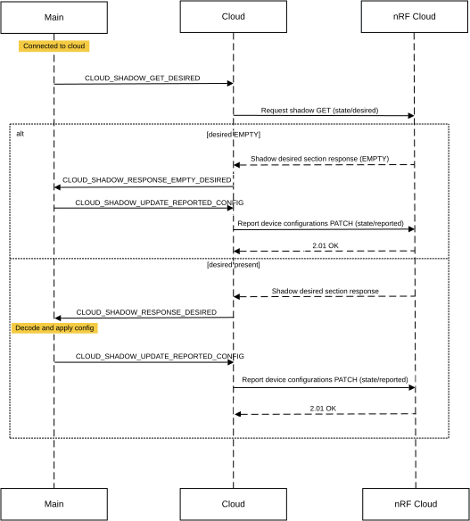
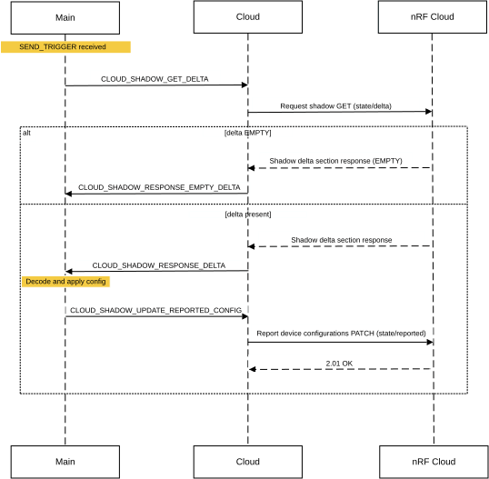
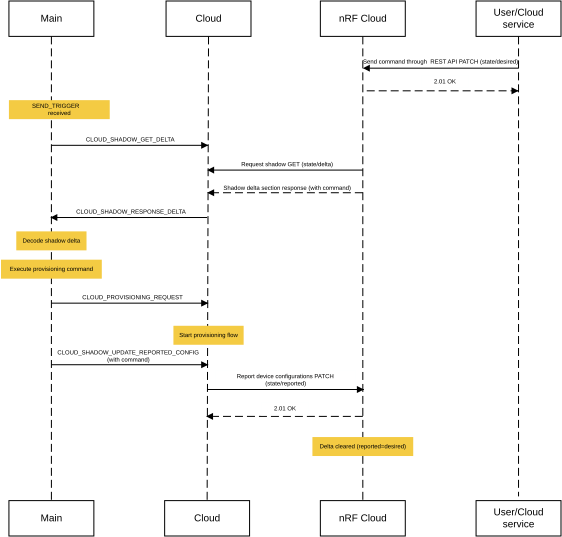

# Configuration

This page describes the compile-time and runtime configuration options that you can use to customize the template's behavior.

## Runtime configurations

The device supports runtime configurations that you can use to modify the template's behavior without firmware updates.

The template uses runtime parameters to control data sampling and cloud update behavior. The device triggers a cloud update when the number of stored samples reaches a configurable threshold. An update sends data, checks for firmware over-the-air (FOTA) jobs, and retrieves configuration and command updates. For implementation details, see [Configuration flow](#configuration-flow).

### Parameters

| Parameter | Description | Unit | Valid range | Static configuration |
|-----------|-------------|------|-------------|----------------------|
| `sample_interval` | Sample interval | Seconds | 1 to 4294967295 | `CONFIG_APP_SAMPLING_INTERVAL_SECONDS` (default: 600) |
| `storage_threshold` | Number of records to store before triggering a cloud update | Records | 1 to `CONFIG_APP_STORAGE_MAX_RECORDS_PER_TYPE` | `CONFIG_APP_STORAGE_INITIAL_THRESHOLD` (default: 1) |

You can set the runtime configurations through the cloud device shadow, where they override the compile-time Kconfig defaults listed in the Static configuration column.

The complete device shadow structure is defined in the [Concise Data Definition Language (CDDL)](https://datatracker.ietf.org/doc/html/rfc8610) schema in the `app/src/cbor/device_shadow.cddl` file. The schema specifies all supported configuration parameters, commands, and their valid value ranges.

### Behavior

- The device samples sensors and location at `sample_interval`.
- The device buffers the data locally.
- The device sends the buffered data when the number of buffered records reaches `storage_threshold`.
- The device polls the shadow and checks for FOTA jobs when a send cycle starts.

> [!NOTE]
> Setting `storage_threshold` to `1` means that the device sends data immediately after each sample.

<!-- Caution -->

> [!CAUTION]
> While low intervals are supported, they can cause network congestion and connectivity issues, especially in poor network conditions. Choose intervals appropriate for your network quality, use case, and device mode.

## Remote configuration from cloud

You can configure the Asset Tracker Template remotely through the device shadow in nRF Cloud.

### Configuration through nRF Cloud UI

> [!NOTE]
> nRF Cloud is transitioning to a Memfault-integrated experience. The following steps use the legacy nRF Cloud portal. After you log in, open the legacy app using the link in the bottom left corner of the new UI.

1. Log in to [nRF Cloud](https://nrfcloud.com).
1. Go to **Devices** and select your device.
1. Select **View Config** on the top bar.
1. Select **Edit Configuration**.
1. Enter the configuration, as shown in the following examples. The order of the keys in the JSON object matters.

    Example 1 sets a 5-minute sampling interval and sends data immediately after each sample:

    ```json
    {
      "sample_interval": 300,
      "storage_threshold": 1
    }
    ```

    Example 2 sets a 10-minute sampling interval and sends data after six samples, which is once per hour:

    ```json
    {
      "sample_interval": 600,
      "storage_threshold": 6
    }
    ```

    **Important:** To remove a configuration entry, set the parameter to `null`.

1. Select **Commit** to apply the changes.

The device receives the new configuration through its shadow and adjusts its
sampling interval and storage mode accordingly.

### Configuration through REST API

You can update the runtime parameters with the [nRF Cloud REST API](https://api.nrfcloud.com/#tag/IP-Devices/operation/UpdateDeviceState).

To get `$API_KEY`, open the legacy app from the bottom left corner of the new nRF Cloud UI, and select your team. Then select the menu button, and go to **User Account** > **Team Details**. The on-target tests use the same key, as `NRFCLOUD_API_KEY`. For more information, see [Managing tokens and keys](https://docs.memfault.com/docs/legacy-nrfcloud/tokens-and-keys).

Example 1 sets a 5-minute sampling interval and sends data immediately after each sample:

```bash
curl -X PATCH "https://api.nrfcloud.com/v1/devices/$DEVICE_ID/state" \
  -H "Authorization: Bearer $API_KEY" \
  -H "Content-Type: application/json" \
  -d '{ "desired": { "config": { "sample_interval": 300, "storage_threshold": 1 } } }'
```

Example 2 sets a 10-minute sampling interval and sends data after six samples, which is once per hour:

```bash
curl -X PATCH "https://api.nrfcloud.com/v1/devices/$DEVICE_ID/state" \
  -H "Authorization: Bearer $API_KEY" \
  -H "Content-Type: application/json" \
  -d '{ "desired": { "config": { "sample_interval": 600, "storage_threshold": 6 } } }'
```

### Commands through REST API

Send device commands using the [nRF Cloud REST API](https://api.nrfcloud.com/#tag/IP-Devices/operation/UpdateDeviceState):

```bash
curl -X PATCH "https://api.nrfcloud.com/v1/devices/$DEVICE_ID/state" \
  -H "Authorization: Bearer $API_KEY" \
  -H "Content-Type: application/json" \
  -d '{"desired": {"command": [1, 1]}}'
```

The command format is `"command": [type, id]`, where the two fields have the following meanings:

- `type`: The command type. The only valid value is `1`, which triggers provisioning.
- `id`: A unique identifier that you increment for successive commands. The valid range is 1 to 4294967295, which excludes `0` and `UINT32_MAX`.

For more information about the shadow structure, see `Asset-Tracker-Template/app/src/cbor/device_shadow.cddl`.

### Configuration flow

The default sampling interval is set from
`CONFIG_APP_SAMPLING_INTERVAL_SECONDS`, and the threshold is set from
`CONFIG_APP_STORAGE_INITIAL_THRESHOLD`. When the device polls the shadow,
it checks for updates to these parameters and applies them at runtime. If a
parameter is not set in the shadow, the device continues using the existing
value (either from Kconfig or a previous shadow update).

To poll the configuration immediately, press and hold **Button 1** on the device. This starts a cloud poll and send cycle that fetches the latest shadow delta.

The following diagrams illustrate what happens in the various scenarios where the device polls the shadow:

<details>
<summary><b>Shadow desired section poll flow</b></summary>



</details>

<details>
<summary><b>Shadow delta section poll flow</b></summary>



</details>

<details>
<summary><b>Shadow delta section poll flow with command execution</b></summary>



</details>

## Location method priorities

The Asset Tracker Template supports multiple location methods, which you can prioritize based on your needs. You set the priorities in board-specific configuration files.

### Available methods

The template supports the following location methods:

- Global Navigation Satellite System (GNSS), including GPS
- Wi-Fi® positioning
- Cellular positioning

### Configuration examples

- **Thingy:91 X configuration** (Wi-Fi available):

    ```kconfig
    CONFIG_LOCATION_REQUEST_DEFAULT_METHOD_FIRST_GNSS=y
    CONFIG_LOCATION_REQUEST_DEFAULT_METHOD_SECOND_WIFI=y
    CONFIG_LOCATION_REQUEST_DEFAULT_METHOD_THIRD_CELLULAR=y
    CONFIG_LOCATION_REQUEST_DEFAULT_WIFI_TIMEOUT=5000
    ```

- **nRF9151 DK configuration** (Wi-Fi unavailable):

    ```kconfig
    CONFIG_LOCATION_REQUEST_DEFAULT_METHOD_FIRST_GNSS=y
    CONFIG_LOCATION_REQUEST_DEFAULT_METHOD_SECOND_CELLULAR=y
    ```

## Storage configuration

The Storage module buffers collected data locally and sends it to the cloud based on the configured sampling interval and threshold. For more information, see [Storage module](../modules/storage.md).

### Buffer and threshold options

To set the buffer size and the number of records per data type, set the following options in `prj.conf`:

```kconfig
CONFIG_APP_STORAGE_MAX_RECORDS_PER_TYPE=8      # Records per data type
CONFIG_APP_STORAGE_BATCH_BUFFER_SIZE=256       # Batch buffer size
CONFIG_APP_STORAGE_INITIAL_THRESHOLD=4         # Number of records to trigger cloud update
```

The `storage_threshold` runtime parameter controls when the device sends buffered data to the cloud. Setting it to `1` means that the device sends data immediately after each sample. Higher values buffer more samples before sending.

For a minimal storage configuration, which keeps a single record per data type and sends a message for every sample, include the `app/overlay-storage-minimal.conf` overlay.

### Shell commands

When `CONFIG_APP_STORAGE_SHELL` is enabled, you can control the module at runtime with the following shell commands:

```bash
att_storage flush              # Flush stored data
att_storage clear              # Clear all data
att_storage stats              # Show statistics (requires CONFIG_APP_STORAGE_SHELL_STATS)
```

For all options, see [Configuration](../modules/storage.md#configuration).

## Network configuration

The template provides Kconfig options for the cellular network modes, the power saving mode, and the access point name.

### Network modes

The modem can use two cellular technologies, and you select which of them to enable and which one to prefer.

#### NB-IoT and LTE-M

The Asset Tracker Template supports both LTE Cat NB1 (NB-IoT) and LTE Cat M1 (LTE-M) cellular connectivity:

- **NB-IoT** is optimized for the following cases:

    - Low data rate applications.
    - Better coverage.
    - Stationary or low-mobility devices.

- **LTE-M** is better suited for the following cases:

    - Higher data rates.
    - Mobile applications.
    - Lower latency requirements.

#### Mode selection

The following network modes are available (`LTE_NETWORK_MODE`):

- **Default**: Use the system mode currently set in the modem.
- **LTE-M**: LTE Cat M1 only.
- **LTE-M and GPS**: LTE Cat M1 with GPS enabled.
- **NB-IoT**: NB-IoT only.
- **NB-IoT and GPS**: NB-IoT with GPS enabled.
- **LTE-M and NB-IoT**: Both LTE-M and NB-IoT enabled.
- **LTE-M, NB-IoT and GPS**: Both LTE modes with GPS.

#### Mode preference

When multiple network modes are enabled (LTE-M and NB-IoT), you can set a mode preference (`LTE_MODE_PREFERENCE`):

- **No preference**: The modem selects the mode automatically.
- **LTE-M**: Prioritize LTE-M over public land mobile network (PLMN) selection.
- **NB-IoT**: Prioritize NB-IoT over PLMN selection.
- **LTE-M, PLMN prioritized**: Prefer LTE-M but prioritize staying on home network.
- **NB-IoT, PLMN prioritized**: Prefer NB-IoT but prioritize staying on home network.

The following example shows the configuration in `prj.conf`:

```kconfig
# Enable both LTE-M and NB-IoT with GPS
CONFIG_LTE_NETWORK_MODE_LTE_M_NBIOT_GPS=y

# Prefer LTE-M while prioritizing home network
CONFIG_LTE_MODE_PREFERENCE_LTE_M_PLMN_PRIO=y
```

### Power saving mode (PSM)

PSM lets the device enter deep sleep while it maintains its network registration. You configure PSM with the following Kconfig options:

- **Periodic tracking area update (TAU)**: Controls how often the device updates its location with the network. Set the interval in seconds with the following option:

    ```kconfig
    # Configure TAU in seconds
    CONFIG_LTE_PSM_REQ_RPTAU_SECONDS=7200  # 2 hours (default in prj.conf)
    ```

- **Requested active time (RAT)**: Defines how long the device stays active after a wake-up. Set the duration in seconds with the following option:

    ```kconfig
    # Configure RAT in seconds
    CONFIG_LTE_PSM_REQ_RAT_SECONDS=6  # 6 seconds (default in prj.conf)
    ```

When PSM is enabled, the following applies:

- The device negotiates the PSM parameters with the network.
- PSM helps achieve longer battery life.
- The device remains registered but unreachable during sleep.
- The device wakes up periodically, based on the TAU setting.
- The device stays active for the duration specified by RAT.

For more information on power configuration, see [Application power configuration](low_power.md#application-power-configuration).

### Access point name (APN)

The access point name (APN) is a network identifier that the device uses to connect to the packet data network of the cellular network. You have the following options:

- **Default APN**: Most carriers automatically configure the correct APN.
- **Manual configuration**: If needed, you can configure the APN through Kconfig:

    ```kconfig
    CONFIG_PDN_DEFAULT_APN="Access point name"
    ```

You typically configure the APN in the following scenarios:

- Using a custom or private APN.
- Connecting to specific network services.
- Working with mobile virtual network operators (MVNOs).

> [!NOTE]
> In most cases, the default APN provided by the carrier should work without additional configuration.
