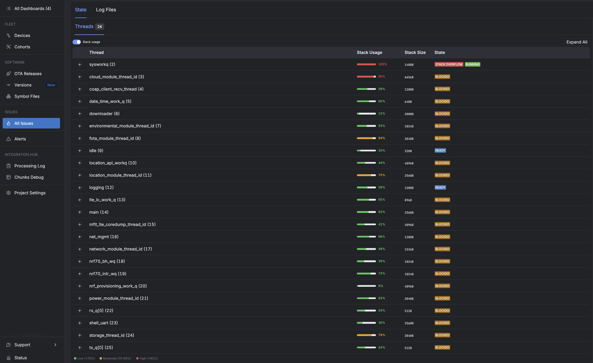

# Tooling and troubleshooting

This page provides an overview of the tools you use to troubleshoot the template code, the modem, and the network behavior.
For more information about debugging and troubleshooting [nRF Connect SDK](https://github.com/nrfconnect/sdk-nrf) based applications in general, see the following resources:

- [Debugging and troubleshooting](https://academy.nordicsemi.com/courses/nrf-connect-sdk-intermediate/lessons/lesson-2-debugging/)
- [Cellular IoT Fundamentals](https://academy.nordicsemi.com/courses/cellular-iot-fundamentals/)
- [Debugging in the nRF Connect SDK](https://docs.nordicsemi.com/bundle/ncs-latest/page/nrf/test_and_optimize/debugging.html)
- [Debugging in Zephyr](https://docs.zephyrproject.org/latest/develop/debug/index.html)

## Shell commands

The template provides several shell commands for controlling and monitoring device behavior. Connect to the device's UART interface using one of the following applications:

- The [Serial Terminal app](https://docs.nordicsemi.com/bundle/nrf-connect-serial-terminal/page/index.html) from nRF Connect for Desktop.
- Your preferred terminal application, for example PuTTY, minicom, or Tera Term.

### Available commands

To list all available commands, run `help`:

```bash
uart:~$ help
Available commands:
  app                          : Application version information commands
  at                           : Execute an AT command
  att_button                   : Asset Tracker Template Button module commands
  att_cloud                    : Asset Tracker Template Cloud module commands
  att_fota                     : Asset Tracker Template FOTA module commands
  att_network                  : Asset Tracker Template Network module commands
  att_power                    : Asset Tracker Template Power module commands
  att_storage                  : Asset Tracker Template Storage module commands
  clear                        : Clear screen.
  date                         : Date commands
  device                       : Device commands
  devmem                       : Read/write physical memory
                                 Usage:
                                 Read memory at address with optional width:
                                 devmem <address> [<width>]
                                 Write memory at address with mandatory width
                                 and value:
                                 devmem <address> <width> <value>
  help                         : Prints the help message.
  history                      : Command history.
  kernel                       : Kernel commands
  pm                           : PM commands
  rem                          : Ignore lines beginning with 'rem '
  resize                       : Console gets terminal screen size or assumes
                                 default in case the readout fails. It must be
                                 executed after each terminal width change to
                                 ensure correct text display.
  retval                       : Print return value of most recent command
  shell                        : Useful, not Unix-like shell commands.
```

### Shell command examples

The following sections show example output for the most common shell commands.

#### Cloud publishing

The `att_cloud publish` command sends a custom payload to nRF Cloud:

```bash
uart:~$ att_cloud publish TEMP "24"
Sending on payload channel: {"messageType":"DATA","appId":"TEMP","data":"24","ts":1744359144653} (68 bytes)
```

#### Perform cloud provisioning

The `att_cloud provision` command contacts the nRF Provisioning Service:

```bash
uart:~$ att_cloud provision
[00:00:42.258,361] <dbg> cloud: state_connected_ready_run: Provisioning request received
[00:00:42.258,453] <dbg> cloud: state_connected_exit: state_connected_exit
...
[00:00:45.086,273] <dbg> nrf_provisioning_coap: request_commands: Path: p/cmd?after=&rxMaxSize=4096&txMaxSize=4096&limit=5
[00:00:45.289,215] <dbg> nrf_provisioning_coap: coap_callback: Callback code 69
[00:00:45.289,245] <dbg> nrf_provisioning_coap: coap_callback: Operation successful
[00:00:45.289,245] <dbg> nrf_provisioning_coap: coap_callback: Last packet received
[00:00:45.289,367] <dbg> nrf_provisioning_coap: nrf_provisioning_coap_req: Response code 69
[00:00:45.289,367] <inf> nrf_provisioning_coap: No commands to process on server side
[00:00:45.290,924] <dbg> nrf_provisioning: check_return_code_and_notify: No commands to process
[00:00:45.290,954] <wrn> cloud: No commands from the nRF Provisioning Service to process
[00:00:45.290,954] <wrn> cloud: Treating as provisioning finished
```

When you call the provisioning command, the device connects to the provisioning endpoint, checks for any pending commands for the device, and executes them if present. Use this command to reprovision the device during development, or when you want to swap out the credentials used in the CoAP connection.

#### Poll for FOTA updates

Use the `att_fota poll` command to trigger a firmware update check against nRF Cloud manually. The device must be connected to the network and the cloud.

```bash
uart:~$ att_fota poll
[00:00:42.258,361] <inf> nrf_cloud_fota_poll: Checking for FOTA job...
[00:00:43.289,245] <inf> nrf_cloud_fota_poll: No pending FOTA job
```

If a FOTA job is available, the FOTA module starts downloading the update automatically. For information about creating and applying update jobs, see [Firmware updates (FOTA)](fota.md).

#### Network disconnect

The `att_network disconnect` command detaches the device from the cellular network:

```bash
uart:~$ att_network disconnect
[00:00:36.758,758] <dbg> network: state_disconnecting_entry: state_disconnecting_entry
[00:00:37.196,746] <wrn> network: Not registered, check rejection cause
[00:00:37.197,021] <dbg> network: lte_lc_evt_handler: PDN connection network detached
[00:00:37.198,608] <dbg> cloud: state_connected_paused_entry: state_connected_paused_entry
[00:00:37.198,974] <dbg> main: wait_for_trigger_exit: wait_for_trigger_exit
[00:00:37.199,005] <dbg> main: idle_entry: idle_entry
[00:00:37.205,444] <dbg> network: state_disconnected_entry: state_disconnected_entry
```

#### AT command execution

The `at` command runs an AT command on the modem. The following example reads the device IMEI:

```bash
uart:~$ at at+cgsn
+CGSN: "123456789012345"
OK
```

The following example reads the current PSM configuration:

```bash
uart:~$ at at+cpsms?
+CPSMS: 1,,,"00001100","00000011"
OK
```

## Debugging tools

The following sections describe the tools you use to profile the power consumption, debug the application, analyze the threads, and inspect the module states.

### Low power profiling

To get a rough estimate of the device's power consumption, and of what to expect depending on your network configuration and data transmission, use the [Online Power Profiler for LTE](https://devzone.nordicsemi.com/power/w/opp/3/online-power-profiler-for-lte).

For exact measurements, use a power analyzer or the [Power Profiler Kit 2](https://www.nordicsemi.com/Products/Development-hardware/Power-Profiler-Kit-2).

For detailed guidance on how to use the PPK to profile and measure power, see the [Power Profiler Kit user guide](https://docs.nordicsemi.com/bundle/ug_ppk2/page/UG/ppk/PPK_user_guide_Intro.html).

### GDB debugging

To debug the template with the GNU Debugger (GDB), use the following west command:

```bash
# Attach GDB, skip rebuilding application
west attach --skip-rebuild
```

The following GDB commands are the most common ones:

```bash
(gdb) tui enable
(gdb) monitor reset
(gdb) break main
(gdb) continue
(gdb) backtrace
(gdb) print variable_name
(gdb) next
(gdb) step
```

For more information, see the following documentation:

- [Debugging with west](https://docs.zephyrproject.org/latest/develop/west/build-flash-debug.html#debugging-west-debug-west-debugserver)
- [Debugging in VS Code](https://academy.nordicsemi.com/courses/nrf-connect-sdk-intermediate/lessons/lesson-2-debugging/topic/debugging-in-vs-code/)
- [GDB manual](https://man7.org/linux/man-pages/man1/gdb.1.html)

### SEGGER SystemView

Analyze the thread execution and scheduling using [SEGGER SystemView](https://www.segger.com/products/development-tools/systemview/), which presents the recorded trace as shown in the following animation:


#### Configuration

Add the following configuration to the `prj.conf` file:

```bash
CONFIG_TRACING=y
CONFIG_SEGGER_SYSTEMVIEW=y
```

Then build and flash the template for the target board, or pass the configurations directly on the `west build` command line:

```bash
west build -p -b <board> -- -DCONFIG_TRACING=y -DCONFIG_SEGGER_SYSTEMVIEW=y
```

Alternatively, use the RTT tracing snippet:

```bash
west build -p -b <board> -- -Dapp_SNIPPET=rtt-tracing
```

### Thread analysis

To monitor and optimize the stack sizes, use the Thread Analyzer.

Add the following configuration to the `prj.conf` file:

```bash
CONFIG_THREAD_ANALYZER=y
CONFIG_THREAD_ANALYZER_USE_LOG=y
CONFIG_THREAD_ANALYZER_AUTO=y
CONFIG_THREAD_ANALYZER_AUTO_INTERVAL=30
CONFIG_THREAD_ANALYZER_AUTO_STACK_SIZE=1024
CONFIG_THREAD_NAME=y
```

These options configure the Thread Analyzer to print thread information every 30 seconds:

```bash
[00:00:30.725,463] <inf> thread_analyzer:  location_api_workq  : STACK: unused 376 usage 3720 / 4096 (90 %); CPU: 0 %
[00:00:30.725,494] <inf> thread_analyzer:                      : Total CPU cycles used: 242
[00:00:30.725,738] <inf> thread_analyzer:  downloader          : STACK: unused 1480 usage 184 / 1664 (11 %); CPU: 0 %
[00:00:30.725,769] <inf> thread_analyzer:                      : Total CPU cycles used: 0
[00:00:30.725,891] <inf> thread_analyzer:  thread_analyzer     : STACK: unused 480 usage 544 / 1024 (53 %); CPU: 0 %
[00:00:30.725,921] <inf> thread_analyzer:                      : Total CPU cycles used: 148
[00:00:30.725,982] <inf> thread_analyzer:  power_task_id       : STACK: unused 168 usage 1176 / 1344 (87 %); CPU: 0 %
[00:00:30.726,013] <inf> thread_analyzer:                      : Total CPU cycles used: 85
[00:00:30.726,104] <inf> thread_analyzer:  network_module_thread_id: STACK: unused 160 usage 1504 / 1664 (90 %); CPU: 0 %
[00:00:30.726,165] <inf> thread_analyzer:                      : Total CPU cycles used: 2011
[00:00:30.726,257] <inf> thread_analyzer:  location_module_thread_id: STACK: unused 216 usage 1000 / 1216 (82 %); CPU: 0 %
[00:00:30.726,287] <inf> thread_analyzer:                      : Total CPU cycles used: 185
[00:00:30.726,440] <inf> thread_analyzer:  fota_task_id        : STACK: unused 968 usage 1536 / 2504 (61 %); CPU: 0 %
[00:00:30.726,470] <inf> thread_analyzer:                      : Total CPU cycles used: 187
[00:00:30.726,562] <inf> thread_analyzer:  environmental_task_id: STACK: unused 168 usage 856 / 1024 (83 %); CPU: 0 %
[00:00:30.726,593] <inf> thread_analyzer:                      : Total CPU cycles used: 37
[00:00:30.726,715] <inf> thread_analyzer:  coap_client_recv_thread: STACK: unused 592 usage 688 / 1280 (53 %); CPU: 0 %
[00:00:30.726,745] <inf> thread_analyzer:                      : Total CPU cycles used: 273
[00:00:30.726,867] <inf> thread_analyzer:  cloud_thread_id: STACK: unused 328 usage 3000 / 3328 (90 %); CPU: 0 %
[00:00:30.726,898] <inf> thread_analyzer:                      : Total CPU cycles used: 1081
[00:00:30.726,959] <inf> thread_analyzer:  date_time_work_q    : STACK: unused 80 usage 368 / 448 (82 %); CPU: 0 %
[00:00:30.726,989] <inf> thread_analyzer:                      : Total CPU cycles used: 11
[00:00:30.727,050] <inf> thread_analyzer:  conn_mgr_monitor    : STACK: unused 72 usage 312 / 384 (81 %); CPU: 0 %
[00:00:30.727,081] <inf> thread_analyzer:                      : Total CPU cycles used: 13
[00:00:30.727,203] <inf> thread_analyzer:  work_q              : STACK: unused 576 usage 192 / 768 (25 %); CPU: 0 %
[00:00:30.727,233] <inf> thread_analyzer:                      : Total CPU cycles used: 3
[00:00:30.727,294] <inf> thread_analyzer:  rx_q[0]             : STACK: unused 24 usage 168 / 192 (87 %); CPU: 0 %
[00:00:30.727,325] <inf> thread_analyzer:                      : Total CPU cycles used: 1
[00:00:30.727,386] <inf> thread_analyzer:  tx_q[0]             : STACK: unused 24 usage 168 / 192 (87 %); CPU: 0 %
[00:00:30.727,416] <inf> thread_analyzer:                      : Total CPU cycles used: 1
[00:00:30.727,539] <inf> thread_analyzer:  net_mgmt            : STACK: unused 504 usage 776 / 1280 (60 %); CPU: 0 %
[00:00:30.727,569] <inf> thread_analyzer:                      : Total CPU cycles used: 124
[00:00:30.727,783] <inf> thread_analyzer:  shell_uart          : STACK: unused 1312 usage 736 / 2048 (35 %); CPU: 0 %
[00:00:30.727,813] <inf> thread_analyzer:                      : Total CPU cycles used: 3971
[00:00:30.727,905] <inf> thread_analyzer:  sysworkq            : STACK: unused 400 usage 880 / 1280 (68 %); CPU: 0 %
[00:00:30.727,935] <inf> thread_analyzer:                      : Total CPU cycles used: 278
[00:00:30.728,027] <inf> thread_analyzer:  nrf70_intr_wq       : STACK: unused 120 usage 712 / 832 (85 %); CPU: 0 %
[00:00:30.728,057] <inf> thread_analyzer:                      : Total CPU cycles used: 806
[00:00:30.728,118] <inf> thread_analyzer:  nrf70_bh_wq         : STACK: unused 112 usage 656 / 768 (85 %); CPU: 0 %
[00:00:30.728,149] <inf> thread_analyzer:                      : Total CPU cycles used: 102
[00:00:30.728,271] <inf> thread_analyzer:  logging             : STACK: unused 448 usage 320 / 768 (41 %); CPU: 0 %
[00:00:30.728,302] <inf> thread_analyzer:                      : Total CPU cycles used: 224
[00:00:30.728,363] <inf> thread_analyzer:  idle                : STACK: unused 256 usage 64 / 320 (20 %); CPU: 98 %
[00:00:30.728,393] <inf> thread_analyzer:                      : Total CPU cycles used: 985191
[00:00:30.728,485] <inf> thread_analyzer:  main                : STACK: unused 208 usage 1648 / 1856 (88 %); CPU: 0 %
[00:00:30.728,515] <inf> thread_analyzer:                      : Total CPU cycles used: 2055
[00:00:30.728,759] <inf> thread_analyzer:  ISR0                : STACK: unused 1736 usage 312 / 2048 (15 %)
```

For more information, see [Thread analyzer](https://docs.zephyrproject.org/latest/services/debugging/thread-analyzer.html) in the Zephyr documentation.

### Hardfaults

When a hardfault occurs, check the [LR and PC](https://stackoverflow.com/questions/8236959/what-are-sp-stack-and-lr-in-arm) registers to find the offending instruction.
In the following fault frame, the PC is `0x00002681`, the thread is `main`, and the error type is a stack overflow.
In this case, you do not need to look up the PC or the LR, because the fault frame already identifies the issue. To fix it, increase the main stack size.

For more information about how to debug hardfaults, see [How to debug a HardFault on an ARM Cortex-M MCU](https://interrupt.memfault.com/blog/cortex-m-hardfault-debug).

```bash
*** Using Zephyr OS v4.0.99-7607c6585566 ***
[00:00:00.756,317] <dbg> main: main: Main has started
[00:00:00.764,770] <err> os: ***** USAGE FAULT *****
[00:00:00.772,552] <err> os:   Stack overflow (context area not valid)
[00:00:00.781,951] <err> os: r0/a1:  0x0000267e  r1/a2:  0x0007b6f7  r2/a3:  0x0000267f
[00:00:00.792,785] <err> os: r3/a4:  0x0007b6f7 r12/ip:  0x00002680 r14/lr:  0x0007b6f7
[00:00:00.803,619] <err> os:  xpsr:  0x0007b600
[00:00:00.811,035] <err> os: s[ 0]:  0x00002682  s[ 1]:  0x0007b6f7  s[ 2]:  0x00002683  s[ 3]:  0x0007b6f7
[00:00:00.823,608] <err> os: s[ 4]:  0x00002684  s[ 5]:  0x0007b6f7  s[ 6]:  0x00002685  s[ 7]:  0x0007b6f7
[00:00:00.836,212] <err> os: s[ 8]:  0x00002686  s[ 9]:  0x0007b6f7  s[10]:  0x00002687  s[11]:  0x0007b6f7
[00:00:00.848,815] <err> os: s[12]:  0x00002688  s[13]:  0x0007b6f7  s[14]:  0x00002689  s[15]:  0x0007b6f7
[00:00:00.861,389] <err> os: fpscr:  0x0000268a
[00:00:00.868,774] <err> os: Faulting instruction address (r15/pc): 0x00002681
[00:00:00.878,845] <err> os: >>> ZEPHYR FATAL ERROR 2: Stack overflow on CPU 0
[00:00:00.888,916] <err> os: Current thread: 0x200132b8 (main)
[00:00:00.897,583] <err> os: Halting system
```

However, if the fault source is more ambiguous, you might need to use `addr2line` to look up the offending function.
In this example, the LR address is used to find the function stored in the LR register.
That function is the caller in the callstack of the address the PC points to.

```bash
<path-to-zephyr-sdk>/arm-zephyr-eabi/bin/arm-zephyr-eabi-addr2line -e build/app/zephyr/zephyr.elf 0x0007b6f7
<path-to-app-dir>/app/src/main.c:771
```

The template is configured to forward logging in TF-M (Secure image) to UART 0 (application log output).
If a secure fault occurs, the fault frame from TF-M will look like this:

```bash
uart:~$ FATAL ERROR: SecureFault
Here is some context for the exception:
    EXC_RETURN (LR): 0xFFFFFFAD
    Exception came from non-secure FW in thread mode.
    xPSR:    0x60000007
    MSP:     0x20000BF8
    PSP:     0x20001CF8
    MSP_NS:  0x2002C580
    PSP_NS:  0x2002CD40
    Exception frame at: 0x2002CD40
        R0:   0x00000000
        R1:   0x00000000
        R2:   0x20013288
        R3:   0x00000000
        R12:  0x00000000
        LR:   0x00044181
        PC:   0x0003D7B6
        xPSR: 0x61000000
    Callee saved register state:        R4:   0x2000D414
        R5:   0x0008A0B8
        R6:   0x00088835
        R7:   0x00000000
        R8:   0x00000000
        R9:   0x00000008
        R10:  0x00048A04
        R11:  0x00048A04
    CFSR:  0x00000000
    BFSR:  0x00000000
    BFAR:  Not Valid
    MMFSR: 0x00000000
    MMFAR: Not Valid
    UFSR:  0x00000000
    HFSR:  0x00000000
    SFSR:  0x00000048
    SFAR: 0x00000000
```

Here we can again look up the PC and LR in the non-secure image to find the offending function:

```bash
~/dev/projects/att/Asset-Tracker-Template/app add-sensor-docs *18 !5 ❯ a2l 0x0003D7B6
/dev/projects/att/Asset-Tracker-Template/app/src/main.c:789
```

Secure faults will display:

- Fault frame information.
- Non-secure SP and LR registers.
- Violation details.

For more information, see the following documentation:

- [TF-M documentation](https://docs.nordicsemi.com/bundle/ncs-latest/page/tfm/introduction/readme.html#repositories)
- [Trusted Firmware-M in the nRF Connect SDK](https://docs.nordicsemi.com/bundle/ncs-latest/page/nrf/security/tfm/index.html)

> [!NOTE]
> On a hardfault, the device might reboot before it flushes the log buffer, so it might not print the fault frame.
> To circumvent this issue, add the following configuration:
>
> ```bash
> CONFIG_LOG_MODE_IMMEDIATE=y
> CONFIG_RESET_ON_FATAL_ERROR=n
> ```

When you enable immediate logging, you might have to increase the stack size of certain threads, because the application emits the log messages in the calling thread's context, which increases the stack usage.

### State inspection script

The `inspect_state.py` script lets you inspect the current state of the application's state machines and internal data structures on a running device. It supports the following two modes of operation:

- **Live inspection**: The script connects to the device using J-Link, parses the ELF file to find the symbol locations and types, and reads the memory to display the current state.
- **Coredump analysis**: The script can also analyze a coredump file that the device generated, which lets you inspect the state at the time of the crash.

The script is particularly useful for debugging when the application is stuck or behaves unexpectedly and you want to see the exact state of each module without halting the CPU or adding extensive logging, and when you analyze crashes.

The script has the following prerequisites:

- Python 3 installed.
- The `pyelftools` package, version 0.30 or later, and the `pylink-square` package:

    ```bash
    pip install "pyelftools>=0.30" pylink-square
    ```

- A J-Link debug probe connected to the device.
- The `zephyr.elf` file that corresponds to the running firmware.

Run the script from the `scripts` directory, or adjust the path, and provide the path to your ELF file and optionally the J-Link device name:

```bash
# Live inspection
python3 Asset-Tracker-Template/scripts/inspect_state.py --elf build/app/zephyr/zephyr.elf
# Coredump analysis
python3 Asset-Tracker-Template/scripts/inspect_state.py --elf path/to/symbols.elf --coredump path/to/coredump.elf
```

The script first shows a summary table of all modules and their current state:

```text
Connecting to J-Link (Cortex-M33)...

...

Module          | Current State                                                | Details
----------------------------------------------------------------------------------------------------
Main            | STATE_CONNECTED_WAITING                                      | Ptr: 0x00094D80
Cloud           | STATE_CONNECTED_READY                                        | Ptr: 0x000966F0
Location        | STATE_LOCATION_SEARCH_INACTIVE                               | Ptr: 0x00096628
Network         | STATE_CONNECTED                                              | Ptr: 0x00094E70
FOTA            | STATE_WAITING_FOR_POLL_REQUEST                               | Ptr: 0x000967A8
Env             | STATE_RUNNING                                                | Ptr: 0x000965BC
Power           | STATE_RUNNING                                                | Ptr: 0x00094F68
Storage         | STATE_BUFFER_IDLE                                            | Ptr: 0x00096848

Options:
  q: Quit
  r: Refresh summary
  1: Inspect Main
  2: Inspect Cloud
  3: Inspect Location
  4: Inspect Network
  5: Inspect FOTA
  6: Inspect Env
  7: Inspect Power
  8: Inspect Storage

Select option: 2
```

Selecting a module, for example `2` for the Cloud module, reveals the detailed structure of its state variable, including all internal members:

```text
--- Cloud State Details ---
Address: 0x0008C8C0
Type: cloud_state
----------------------------------------
ctx                 : STATE_CONNECTED_READY
chan                : 0x0008BE5C
msg_buf             : Array[584] (too large to display)
network_connected   : 1 (0x1)
provisioning_ongoing: 0 (0x0)
connection_attempts : 2 (0x2)
backoff_time        : 60 (0x3C)
----------------------------------------
```

#### Memory section placement for state objects

The template places all module state objects, which are the Main, Cloud, Location, Network, and Storage module objects, explicitly in the `.data` section of memory using the `__attribute__((section(".data")))` compiler attribute:

```c
/* Place state object in .data section to ensure it is captured in coredumps
 * and can be inspected by external tools during state analysis. */
__attribute__((section(".data"))) static struct main_state main_state = {
    .sample_interval_sec = CONFIG_APP_SAMPLING_INTERVAL_SECONDS,
    .storage_threshold = CONFIG_APP_STORAGE_INITIAL_THRESHOLD,
    .first_sample_pending = true,
};
```

By default, Memfault coredumps do not include the `.bss` section.
Without explicit initialization or attribute placement in the `.data` section, the compiler would place the state objects in `.bss`, and they would not appear in coredumps.
Placing these objects in `.data` captures them in the Memfault coredumps, so the `inspect_state.py` script can inspect them when you analyze crashes after the fact.
As a result, you can access the complete state of all module state machines at the time of the crash or event, even in post-mortem debugging scenarios where the device is not under a live debugger.

## Memfault remote debugging

Memfault is enabled by default in all standard firmware builds. Once a device is provisioned to nRF Cloud, it automatically forwards coredumps, LTE and location metrics, and other diagnostic data to the Memfault project linked to your account through nRF Cloud CoAP.

For deeper post-mortem analysis, you can also capture modem traces around application crashes and upload them to Memfault. Use the pre-built `-debug-thingy91x` [release artifact](release.md#debug-variant), or apply the modem trace overlay when building locally, as described in [Use Memfault](#use-memfault).

Remote debugging enables the device to send metrics such as LTE, location, and memory statistics, as well as coredump captures on crashes, so you can analyze problems across single devices or a fleet of devices once they occur.

### When to use Memfault

Memfault is a device observability platform that complements traditional debugging tools by providing remote diagnostics and fleet-wide insights. It is particularly valuable in the following situations:

- The devices are deployed in remote or inaccessible locations, and you need to capture crashes and diagnostics without physical access or a live debug session.
- The issues only reproduce under real network conditions, or they occur sporadically and are difficult to recreate on the bench.
- You need the full post-mortem context to find the root cause of crashes after the fact, such as the register state, the stack traces, the memory contents, and optionally the modem traces.
- You want to track the device health, the LTE connectivity, the stack usage, and the memory statistics across an entire fleet, and watch the trends over time.
- You want to spot systemic issues that affect specific firmware versions, hardware batches, or network configurations, and collect crash data to identify recurring patterns.

### Use Memfault

To set up remote debugging with Memfault, complete the following steps:

1. Provision the device.

    Follow [Getting started](getting_started.md) to connect the device to your nRF Cloud instance.

    Once provisioned, the device forwards coredumps and metrics automatically to the Memfault project linked to your nRF Cloud account. The device also uploads modem traces on a crash when you use the `-debug-thingy91x` release artifact or the modem trace overlay.

1. Open the Memfault dashboard.

    1. Log in at [nRF Cloud](https://nrfcloud.com). You land in the new Memfault-integrated nRF Cloud experience, which is the Memfault dashboard for your linked project.
    1. Onboard the device in the new UI, under **Fleet** > **Devices** > **Add devices**, as described in [Connecting](connecting.md). The other device-management UI steps in these guides, such as the shadow configuration, still use the legacy nRF Cloud portal. Open it using the link in the bottom left corner of the new UI.

1. Upload the firmware symbol file.

    Upload the `zephyr.elf` file once per build, either from the Memfault UI, under **Symbol Files** > **Upload Symbol File**, where you select `build/app/zephyr/zephyr.elf`, or from the command line using the [Memfault CLI](https://docs.memfault.com/docs/ci/install-memfault-cli):

    ```bash
    memfault \
        --org-token <YOUR_ORG_TOKEN> \
        --org <YOUR_ORG_SLUG> \
        --project <YOUR_PROJECT_SLUG> \
        upload-mcu-symbols build/app/zephyr/zephyr.elf
    ```

    Memfault needs the build's `zephyr.elf` to decode the crash addresses into function names, line numbers, and variable names.

1. List your devices.

    1. In the Memfault UI, select **Devices** in the left toolbar to see all devices that have reported data.
    1. Select a device to explore its coredumps, metrics, and modem traces, which are custom data recordings (CDRs).

    All standard builds include Memfault coredump capture and fleet metrics through nRF Cloud CoAP.
    To also upload modem traces on application crashes, either flash the pre-built `-debug-thingy91x` firmware from the [release page](release.md#debug-variant), or include both the `overlay-upload-modem-traces-to-memfault.conf` Kconfig overlay and the `overlay-upload-modem-traces-to-memfault.overlay` devicetree overlay in your west build command:

    ```bash
    west build -p -b <board> -- \
        -DEXTRA_CONF_FILE="overlay-upload-modem-traces-to-memfault.conf" \
        -DEXTRA_DTC_OVERLAY_FILE="overlay-upload-modem-traces-to-memfault.overlay"
    ```

> [!NOTE]
> The modem trace upload feature can send upwards of 1 MB of modem trace data in case of application crashes.
> Consider this when planning your data usage and costs.
>
> You can also decrypt the traces uploaded to Memfault, so you can inspect the nRF Cloud CoAP exchange leading up to a crash.
> For more information, see [Decrypted traces uploaded to Memfault](#decrypted-traces-uploaded-to-memfault).

The following image shows an example of a coredump received in Memfault:



#### Test shell commands

To trigger test faults, use the following shell commands:

```bash
uart:~$ mflt test hardfault
uart:~$ mflt test assert
uart:~$ mflt test usagefault
```

## Modem tracing

Capture and analyze the modem behavior live, which includes the AT, LTE, and IP traffic, using Wireshark.

### UART tracing

Build and flash the application with `overlay-modem-trace-over-uart.conf` and `overlay-modem-trace-shmem.overlay`:

```bash
west build -p -b <board> --sysbuild -- \
    -DEXTRA_CONF_FILE="overlay-modem-trace-over-uart.conf" \
    -DEXTRA_DTC_OVERLAY_FILE="overlay-modem-trace-shmem.overlay" \
    && west flash --recover

```

Capture the traces with the Cellular Monitor application in [nRF Connect for Desktop](https://www.nordicsemi.com/Products/Development-tools/nRF-Connect-for-Desktop), or manually with nRF Util:

```bash
nrfutil trace lte --input-serialport /dev/tty.usbmodem141405 --output-pcapng trace.pcapng
```

```bash
~/pcap ❯ nrfutil trace lte --input-serialport /dev/tty.usbmodem141405 --output-pcapng trace.pcapng                                                                                                                                    10:25:31
⠒ Saving trace to trace.pcapng (11952 bytes)
```

If nRF Util captures no traces, reset the device.
After the capture, open the trace in Wireshark:

```bash
wireshark trace.pcapng
```

You can also trace live by piping the traces to Wireshark:

```bash
nrfutil trace lte --input-serialport /dev/tty.usbmodem141405 --output-pcapng trace.pcapng --output-wireshark wireshark
```

### RTT tracing

Build and flash the application with the `nrf91-modem-trace-rtt` snippet and `overlay-modem-trace-shmem.overlay`:

```bash
west build -p -b <board> --sysbuild -- \
    -Dapp_SNIPPET=nrf91-modem-trace-rtt \
    -DEXTRA_DTC_OVERLAY_FILE="overlay-modem-trace-shmem.overlay" \
    && west flash --recover
```

Capture the modem traces with the SEGGER J-Link RTT Logger:

```bash
JLinkRTTLogger -Device NRF9160_XXAA -If SWD -Speed 50000 -RTTChannel 1 modem_trace.bin
```

Convert the trace file to PCAPNG with nRF Util or the Cellular Monitor application:

```bash
nrfutil trace lte --input-file modem_trace.bin --output-pcapng rtt-trace.pcapng
```

### Decrypting DTLS traffic in modem traces

The following sections describe the requirements for decrypting the nRF Cloud CoAP traffic in a modem trace, how to build the firmware for it, how to capture and inspect the decrypted traffic, and how to provision the certificate that the nRF9151 DK needs.

By default, nRF Cloud CoAP traffic appears in a modem trace as encrypted DTLS records, so Wireshark cannot show the CoAP and CBOR payloads.
The modem exposes the session keys to Nordic tools when the DTLS connection uses a security tag in the reserved developer range `NRF_SEC_TAG_TLS_DECRYPT_0` to `NRF_SEC_TAG_TLS_DECRYPT_19` (`2147483648` to `2147483667`).
Building the template with the CoAP security tag pointed at one of these tags gives you fully decoded nRF Cloud traffic in Wireshark.

> [!CAUTION]
> The developer security tags are intended for development and testing only.
> Any trace captured from a session that uses them can be decrypted with Nordic tools.
> Never ship production firmware configured this way.

#### Requirements

Decrypting the DTLS traffic has the following requirements:

- A device running `mfw_nrf91x1` v2.0.0 or later. Check the modem firmware version with `at at+cgmr`.
- Modem traces enabled, as described in [UART tracing](#uart-tracing) or [RTT tracing](#rtt-tracing).
- The device onboarded and provisioned to nRF Cloud, as described in [Connecting](connecting.md).
- The nRF Cloud CoAP root CA certificate present in the developer security tag:

    - **Thingy:91 X**: The certificate is written to the developer security tag during production, so no action is needed.
    - **nRF9151 DK**: You must provision the certificate yourself first, as described in [Provisioning the CoAP CA certificate on the nRF9151 DK](#provisioning-the-coap-ca-certificate-on-the-nrf9151-dk).

#### Building with the developer security tag

Two Kconfig options control which security tags the Cloud module uses:

- `CONFIG_NRF_CLOUD_COAP_SEC_TAG`: Holds the CA certificate used to verify the nRF Cloud CoAP server during the DTLS handshake. Point this option at the developer tag.
- `CONFIG_NRF_CLOUD_COAP_JWT_SEC_TAG`: Holds the private key used to sign the JWT that authenticates the device to nRF Cloud. Keep this option at `16842753`, which is the security tag where the nRF Provisioning Service stores the cloud access key.

> [!CAUTION]
> `CONFIG_NRF_CLOUD_COAP_JWT_SEC_TAG` defaults to the value of `CONFIG_NRF_CLOUD_COAP_SEC_TAG`, so you must set it explicitly.
> If you only override the CoAP security tag, the device signs its JWT with a key that nRF Cloud does not recognize, and the authentication fails even though the DTLS handshake succeeds.

Build and flash with UART tracing and the developer security tag.

For the Thingy:91 X, run the following command:

```bash
west build -p -b thingy91x/nrf9151/ns --sysbuild -- \
    -DEXTRA_CONF_FILE="overlay-modem-trace-over-uart.conf" \
    -DEXTRA_DTC_OVERLAY_FILE="overlay-modem-trace-shmem.overlay" \
    -DCONFIG_NRF_CLOUD_COAP_SEC_TAG=2147483667 \
    -DCONFIG_NRF_CLOUD_COAP_JWT_SEC_TAG=16842753 \
    && west flash --recover
```

For the nRF9151 DK, run the following command:

```bash
west build -p -b nrf9151dk/nrf9151/ns --sysbuild -- \
    -DEXTRA_CONF_FILE="overlay-modem-trace-over-uart.conf" \
    -DEXTRA_DTC_OVERLAY_FILE="overlay-modem-trace-shmem.overlay" \
    -DCONFIG_NRF_CLOUD_COAP_SEC_TAG=2147483667 \
    -DCONFIG_NRF_CLOUD_COAP_JWT_SEC_TAG=16842753 \
    && west flash --recover
```

#### Capturing and inspecting decrypted traffic

The [Cellular Monitor app](https://docs.nordicsemi.com/bundle/nrf-connect-cellularmonitor/page/index.html) handles the trace database selection and the Wireshark hand-off for you:

1. Connect the device over USB and open Cellular Monitor.
1. Set **Modem trace database** to **Autoselect**, or to the modem firmware version programmed on the device.
1. Select **Open in Wireshark**.
1. Select **Start** and let the device connect to nRF Cloud.
1. In Wireshark, expand a DTLS packet and look for the **Decrypted TLS** layer in the packet details pane. The decoded CoAP request or response and its CBOR payload appear underneath.

You can also capture with nRF Util as described in [UART tracing](#uart-tracing), and open the resulting `.pcapng` file afterwards.

If the **Decrypted TLS** layer is missing, check the following points:

- The build actually used the developer security tag. Verify with `rg NRF_CLOUD_COAP_SEC_TAG build/app/zephyr/.config`.
- The trace database matches the modem firmware on the device.
- The trace covers the DTLS handshake. The keys are exported with the handshake, so a trace started mid-session cannot be decrypted. Reset the device with the capture running, either physically or by running `kernel reboot` in the shell.

#### Decrypted traces uploaded to Memfault

Decryption is a property of the DTLS session, not of the trace backend. Once the device is built with the developer security tag, provisioned, and producing decodable traces locally, the same traces remain decodable when the device is configured to upload modem traces to Memfault on a coredump.

Combine the developer security tag with the Memfault modem trace overlays, as described in [Memfault remote debugging](#memfault-remote-debugging).

For the Thingy:91 X, run the following command:

```bash
west build -p -b thingy91x/nrf9151/ns --sysbuild -- \
    -DEXTRA_CONF_FILE="overlay-upload-modem-traces-to-memfault.conf" \
    -DEXTRA_DTC_OVERLAY_FILE="overlay-upload-modem-traces-to-memfault.overlay" \
    -DCONFIG_NRF_CLOUD_COAP_SEC_TAG=2147483667 \
    -DCONFIG_NRF_CLOUD_COAP_JWT_SEC_TAG=16842753 \
    && west flash --recover
```

For the nRF9151 DK, run the following command:

```bash
west build -p -b nrf9151dk/nrf9151/ns --sysbuild -- \
    -DEXTRA_CONF_FILE="overlay-upload-modem-traces-to-memfault.conf" \
    -DEXTRA_DTC_OVERLAY_FILE="overlay-upload-modem-traces-to-memfault.overlay" \
    -DCONFIG_NRF_CLOUD_COAP_SEC_TAG=2147483667 \
    -DCONFIG_NRF_CLOUD_COAP_JWT_SEC_TAG=16842753 \
    && west flash --recover
```

Download the trace from the device timeline in Memfault, convert it with nRF Util or the Cellular Monitor app, and open it in Wireshark. The **Decrypted TLS** layer is present exactly as it is for a live capture:

```bash
nrfutil trace lte --input-file memfault-modem-trace.bin --output-pcapng memfault-trace.pcapng
```

This lets you inspect the nRF Cloud CoAP exchange leading up to a crash on a device that is not attached to a debugger.

#### Provisioning the CoAP CA certificate on the nRF9151 DK

The nRF9151 DK does not ship with the nRF Cloud CoAP root CA in the developer security tag, so you must install it once.

1. Save the nRF Cloud CoAP root CA certificate to a file named `coap_ca.pem`.
   The certificate is maintained in the [`ca_certs.py`](https://github.com/nRFCloud/utils/blob/main/src/nrfcloud_utils/ca_certs.py) file in the nRF Cloud utils repository.
   Copy the value of the `nrf_cloud_coap_ca` variable, including the `BEGIN CERTIFICATE` and `END CERTIFICATE` lines.

    **Note:** You only need the CoAP root CA. The AWS root CA in the same file is used for MQTT, REST, and HTTP file downloads, none of which the template uses.

1. Install [nrfcredstore](https://github.com/NordicSemiconductor/nrfcredstore):

    ```bash
    pip3 install -r nrf/scripts/requirements-extra.txt
    ```

1. Disconnect from the network before writing the credentials. Credential storage only succeeds when the modem is offline. In the device shell, run the following command:

    ```bash
    uart:~$ att_network disconnect
    ```

    Then close the serial terminal so `nrfcredstore` can open the UART exclusively for credential writing.

1. Write the certificate to security tag `2147483667`:

    ```bash
    nrfcredstore <serial port> write 2147483667 ROOT_CA_CERT coap_ca.pem
    ```

    The tool autodetects whether the device exposes a raw AT interface or the AT shell. If autodetection fails, force the interface used by the template with `nrfcredstore --cmd-type shell <serial port> write ...`.

1. Verify that the certificate is in place:

    ```bash
    nrfcredstore <serial port> list --tag 2147483667
    Secure tag   Key type           SHA
    2147483667   ROOT_CA_CERT       XXXXXXXXXXXXXXXXXXXXXXXXXXXXXXXXXXXXXXXXXXXXXXXXXXXXXXXXXXXXXXXX
    ```

    A `ROOT_CA_CERT` entry for security tag `2147483667` means that the root CA is stored and that the modem can verify the DTLS handshake against it.

### Dumping modem traces over UART after capture

You can configure the device to capture modem traces continuously to external flash memory. After the capture, you can use a shell command to dump the stored traces over UART with the [Cellular Monitor app](https://docs.nordicsemi.com/bundle/nrf-connect-cellularmonitor/page/index.html) for storage and analysis.

> [!NOTE]
> On top of the following Kconfig options, the flash trace backend needs two things from devicetree: the modem trace shared-memory region, which the note in [UART tracing](#uart-tracing) describes, and a dedicated `modem_trace` flash partition. The `app/overlay-upload-modem-traces-to-memfault.overlay` file already declares both, and you can use it directly or copy it as a starting point. Pass it on the build command line with `-DEXTRA_DTC_OVERLAY_FILE="overlay-upload-modem-traces-to-memfault.overlay"`.

Add the following configuration to the `prj.conf` file:

```bash
CONFIG_FCB=y
CONFIG_FLASH_MAP=y
CONFIG_NRF_MODEM_LIB_TRACE=y
CONFIG_NRF_MODEM_LIB_TRACE_LEVEL_LTE_AND_IP=y
CONFIG_NRF_MODEM_LIB_TRACE_BACKEND_FLASH=y
CONFIG_NRF_MODEM_TRACE_FLASH_NOSPACE_ERASE_OLDEST=y
CONFIG_NRF_MODEM_LIB_TRACE_STACK_SIZE=896
CONFIG_NRF_MODEM_LIB_TRACE_FLASH_SECTORS=255
CONFIG_NRF_MODEM_LIB_TRACE_BACKEND_FLASH_PARTITION_SIZE=0xFF000
CONFIG_NRF_MODEM_LIB_SHELL_TRACE=y
```

> [!NOTE]
> The flash partition size configuration allocates 255 sectors of 4 kB each, which is approximately 1 MB, for trace storage.
> Adjust the `CONFIG_NRF_MODEM_LIB_TRACE_FLASH_SECTORS` and `CONFIG_NRF_MODEM_LIB_TRACE_BACKEND_FLASH_PARTITION_SIZE` Kconfig options according to your available flash memory.
>
> Depending on the trace level and the network and IP activity, the trace buffer might get full. Because of a current limitation in Zephyr, the maximum size of the buffer is approximately 1 MB.
>
> To mitigate buffer overflow issues, adjust the trace level through the `CONFIG_NRF_MODEM_LIB_TRACE_LEVEL` choice symbol:
>
> - **`CONFIG_NRF_MODEM_LIB_TRACE_LEVEL_OFF`**: Disables the output.
> - **`CONFIG_NRF_MODEM_LIB_TRACE_LEVEL_COREDUMP_ONLY`**: Coredump only.
> - **`CONFIG_NRF_MODEM_LIB_TRACE_LEVEL_IP_ONLY`**: IP only.
> - **`CONFIG_NRF_MODEM_LIB_TRACE_LEVEL_LTE_AND_IP`**: LTE and IP, which Nordic Semiconductor recommends for most use cases.
> - **`CONFIG_NRF_MODEM_LIB_TRACE_LEVEL_FULL`**: LTE, IP, GNSS, and coredump, which has the highest data volume.
>
> The trace level sets how often the trace buffer fills up. When the trace buffer gets full, the backend overwrites the oldest entry.
> To prevent the overwrite, disable `CONFIG_NRF_MODEM_TRACE_FLASH_NOSPACE_ERASE_OLDEST`.

The following `modem_trace` shell commands are available:

```bash
modem_trace - Commands for controlling modem trace functionality.
Subcommands:
  start      : Start modem tracing.
  stop       : Stop modem tracing.
  clear      : Clear captured trace data and prepare the backend for capturing
               new traces.
               This operation is only supported with some trace backends.
  size       : Read out the size of stored modem traces.
               This operation is only supported with some trace backends.
  dump_uart  : Dump stored traces to UART.
```

To capture the traces, complete the following steps:

1. Connect to the device using a serial terminal.
1. Start capturing the traces with the [Cellular Monitor app](https://docs.nordicsemi.com/bundle/nrf-connect-cellularmonitor/page/index.html) on UART 1, or run the following nRF Util command:

    ```bash
    nrfutil trace lte --input-serialport /dev/tty.usbmodemxxxxxx --output-raw raw-file.bin
    ```

1. Execute the dump command:

    ```bash
    uart:~$ modem_trace stop
    uart:~$ modem_trace dump_uart
    ```

1. Once the capture completes, convert the traces to PCAP in the Cellular Monitor app for analysis.

### Parallel capture of application logs and modem traces over RTT

To capture modem traces and application logs over RTT simultaneously, add the following configuration to the `prj.conf` file:

```bash
CONFIG_USE_SEGGER_RTT=y
CONFIG_LOG_BACKEND_RTT=y
CONFIG_SHELL_BACKEND_RTT=y
CONFIG_SHELL_BACKEND_RTT_BUFFER=1
```

Capture the logs and the traces in separate terminals on different RTT channels:

```bash
# Terminal 1 - Modem traces
JLinkRTTLogger -Device NRF9160_XXAA -If SWD -Speed 50000 -RTTChannel 2 modem_trace.bin

# Terminal 2 - Application logs
JLinkRTTLogger -Device NRF9160_XXAA -If SWD -Speed 50000 -RTTChannel 0 terminal.txt
```

> [!NOTE]
> You might have to adjust the RTT channel numbers depending on your configuration.
> The default channel mapping is the following:
>
> - Terminal: 0
> - Shell: 1
> - Modem trace: 2

For more information, see [Modem trace module](https://docs.nordicsemi.com/bundle/ncs-latest/page/nrfxlib/nrf_modem/doc/modem_trace.html) in the nRF Connect SDK documentation.

## Common issues and solutions

If you cannot resolve the issue with the tools and instructions in this documentation, create an issue in the [Asset Tracker Template repository](https://github.com/nrfconnect/Asset-Tracker-Template/issues) or register a support ticket on [DevZone](https://devzone.nordicsemi.com).
