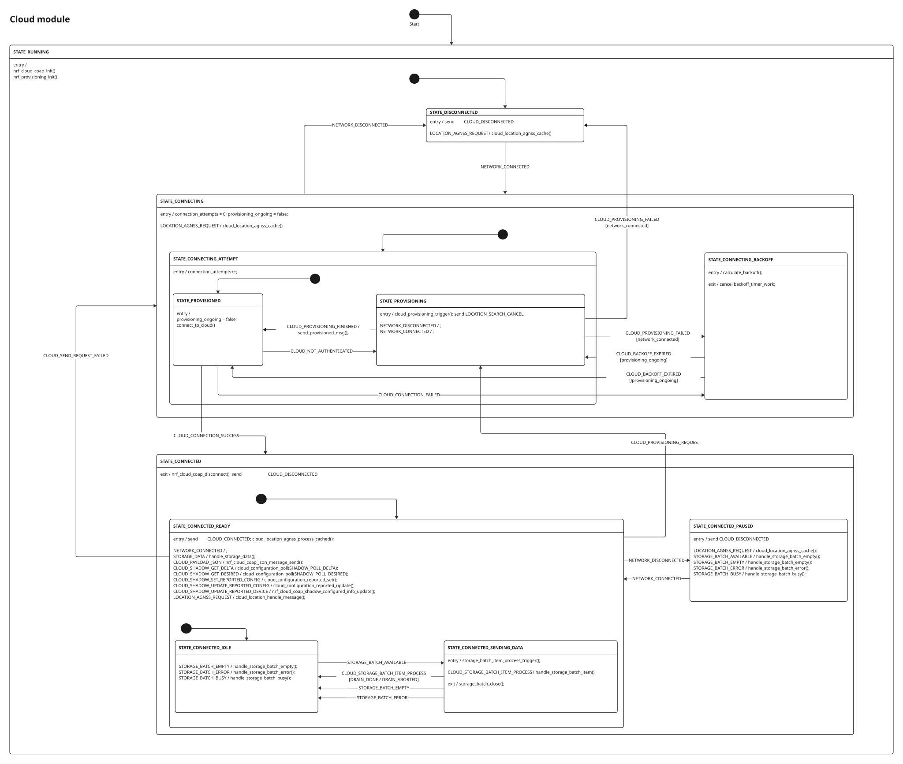

# Cloud module

The Cloud module connects and manages communication with [nRF Cloud](https://www.nrfcloud.com) over the Constrained Application Protocol (CoAP), using the [nRF Cloud CoAP](https://docs.nordicsemi.com/bundle/ncs-latest/page/nrf/libraries/networking/nrf_cloud_coap.html) library in the nRF Connect SDK. It controls the cloud connection, sends data to nRF Cloud, and processes incoming data such as the device shadow document. The Cloud module uses Zephyr's [State Machine Framework](https://docs.nordicsemi.com/bundle/ncs-latest/page/zephyr/services/smf/index.html) (SMF) and zbus for messaging with other modules.

The module performs the following tasks:

- Establishing and maintaining a connection to nRF Cloud, using CoAP with a Datagram Transport Layer Security (DTLS) connection ID for secure and low-power communication.
- Managing backoff and retries when connecting to the cloud. For information about configuring the backoff behavior, see [Configuration](#configuration).
- Publishing sensor data (temperature, pressure, battery, location, and so on) to nRF Cloud. Data reaches the Cloud module through the [Storage module](storage.md) batch interface on `storage_chan` and `storage_data_chan`.
- Requesting and handling shadow updates. The Main module triggers device shadow polling by sending `CLOUD_SHADOW_GET_DESIRED` or `CLOUD_SHADOW_GET_DELTA` messages.
- Handling network events and transitioning between connection states, as described in [State diagram](#state-diagram).

The DTLS connection ID lets the device re-establish a secure connection with the cloud quickly after a network disconnection, without a full DTLS handshake. The module uses the nRF Cloud CoAP library to handle the CoAP communication and the DTLS connection management.

The following sections cover the module's main messages, configuration options, and state machine. For implementation details, see the `cloud.c`, `cloud.h`, and `Kconfig.cloud` source files.

## Architecture

The following sections describe the module's state machine and its interaction with the Storage module.

### State diagram

The Cloud module implements a state machine with the following states and transitions:



### Integration with the Storage module

The Cloud module subscribes to the `storage_chan` and `storage_data_chan` channels to receive data
from the Storage module.
It handles `STORAGE_BATCH_AVAILABLE`, `STORAGE_BATCH_EMPTY`, `STORAGE_BATCH_BUSY`, and
`STORAGE_BATCH_ERROR` messages on the `storage_chan` channel to manage batch data flow.

On `STORAGE_BATCH_AVAILABLE`, the Cloud module enters the
`STATE_CONNECTED_SENDING_DATA` state and drains the batch without blocking, one
item per `CLOUD_STORAGE_BATCH_ITEM_PROCESS` event. Each step reads the head item
with `storage_batch_read()` and sends it to nRF Cloud. Reading an item does not
remove it from storage. Once an item is successfully transmitted, the Cloud
module publishes `STORAGE_BATCH_CONSUME`, which removes it from the backend and
primes the next item.

The batch completes when `storage_batch_read()` returns `-ENODATA` (the Storage
module's end-of-batch marker), returning the module to `STATE_CONNECTED_READY`.
On a network send error, or on `STORAGE_BATCH_EMPTY` or `STORAGE_BATCH_ERROR`,
the module aborts the session without consuming the item, so the data is retained for
the next batch attempt. The `STATE_CONNECTED_SENDING_DATA` exit action issues
`STORAGE_BATCH_CLOSE` to end the session on every exit path.

The module also handles `STORAGE_DATA` messages on the `storage_data_chan` channel to forward individual data items to nRF Cloud.

## Messages

The Cloud module publishes and receives messages over the zbus channel `cloud_chan`. All module message types are defined in `cloud.h` and used within `cloud.c`.

### Input messages

The module accepts the following input messages:

- **CLOUD_SHADOW_GET_DESIRED**: Requests the desired section of the device shadow from nRF Cloud.
- **CLOUD_SHADOW_GET_DELTA**: Requests the delta section of the device shadow, which is the difference between the reported and the desired state.
- **CLOUD_SHADOW_SET_REPORTED_CONFIG**, **CLOUD_SHADOW_UPDATE_REPORTED_CONFIG**, and **CLOUD_SHADOW_UPDATE_REPORTED_DEVICE**: Report the configuration, configuration changes, or device information to the shadow's reported section.
- **CLOUD_PAYLOAD_JSON**: Sends raw JSON data to nRF Cloud.
- **CLOUD_PROVISIONING_REQUEST**: Initiates or re-runs device provisioning through the nRF Cloud provisioning service.

### Output messages

The module publishes the following output messages:

- **CLOUD_DISCONNECTED**: Indicates that the cloud connection is not established, or that it has been lost.
- **CLOUD_CONNECTED**: Indicates that the module is connected to nRF Cloud and ready to send data.
- **CLOUD_SHADOW_RESPONSE_DESIRED** and **CLOUD_SHADOW_RESPONSE_DELTA**: Return CBOR-encoded shadow data from the desired or the delta section.
- **CLOUD_SHADOW_RESPONSE_EMPTY_DESIRED** and **CLOUD_SHADOW_RESPONSE_EMPTY_DELTA**: Indicate that the requested shadow section has no data.
- **CLOUD_PROVISIONED**: Indicates that provisioning completed and that the device is ready to connect.

The message structure used by the Cloud module is defined in `cloud.h`:

```c
struct cloud_msg {
	enum cloud_msg_type type;
	union  {
		struct cloud_payload payload;
		struct cloud_shadow_response response;
	};
};
```

## Configuration

You can configure the Cloud module with the following Kconfig options from `Kconfig.cloud`:

- **CONFIG_APP_CLOUD_SHELL**: Enables shell support for cloud operations.
- **CONFIG_APP_CLOUD_PAYLOAD_BUFFER_MAX_SIZE**: Defines the maximum size for JSON payloads sent to the cloud.
- **CONFIG_APP_CLOUD_SHADOW_RESPONSE_BUFFER_MAX_SIZE**: Sets the maximum buffer size for receiving shadow data.
- **CONFIG_APP_CLOUD_CONFIRMABLE_MESSAGES**: Uses confirmable CoAP messages for reliability.
- **CONFIG_APP_CLOUD_BACKOFF_INITIAL_SECONDS**: Starting delay in seconds before reconnect attempts.
- **CONFIG_APP_CLOUD_BACKOFF_TYPE**: Specifies the backoff strategy, which is none, linear, or exponential.
- **CONFIG_APP_CLOUD_BACKOFF_TYPE_EXPONENTIAL**: Uses exponential backoff time. The module doubles the backoff time after each failed attempt until it reaches the maximum backoff time.
- **CONFIG_APP_CLOUD_BACKOFF_TYPE_LINEAR**: Uses linear backoff time. The module increments the backoff time by a fixed amount after each failed attempt until it reaches the maximum backoff time.
- **CONFIG_APP_CLOUD_BACKOFF_LINEAR_INCREMENT_SECONDS**: Defines how much time linear backoff adds after each failed attempt.
- **CONFIG_APP_CLOUD_BACKOFF_MAX_SECONDS**: Maximum reconnect backoff limit.
- **CONFIG_APP_CLOUD_HANDLE_WRONG_SAMPLE_TIMESTAMPS_DROP**: Drops samples with invalid timestamps when sending data to the cloud.
- **CONFIG_APP_CLOUD_HANDLE_WRONG_SAMPLE_TIMESTAMPS_KEEP**: Sends samples with invalid timestamps to the cloud without modification.
- **CONFIG_APP_CLOUD_HANDLE_WRONG_SAMPLE_TIMESTAMPS_NOW**: Replaces invalid timestamps with the current time before sending to the cloud.
- **CONFIG_APP_CLOUD_HANDLE_WRONG_SAMPLE_TIMESTAMPS_NO_TIMESTAMP**: Sends samples with invalid timestamps to the cloud with `NRF_CLOUD_NO_TIMESTAMP`, which makes nRF Cloud assign the timestamp on reception.
- **CONFIG_APP_CLOUD_THREAD_STACK_SIZE**: Stack size for the Cloud module's main thread.
- **CONFIG_APP_CLOUD_MESSAGE_QUEUE_SIZE**: Size of the zbus message queue.
- **CONFIG_APP_CLOUD_WATCHDOG_TIMEOUT_SECONDS**: Watchdog timeout for the module's thread. This value must be larger than the message processing timeout.
- **CONFIG_APP_CLOUD_MSG_PROCESSING_TIMEOUT_SECONDS**: Maximum time allowed for processing a single incoming message.

For more information about these and other configuration options, see the `Kconfig.cloud` file.

## Shell commands

When `CONFIG_APP_CLOUD_SHELL` is enabled, the following shell commands are available:

```bash
att_cloud publish <appid> <data>   # Publish custom data to nRF Cloud
att_cloud provision                # Connect to the nRF Cloud provisioning service
att_cloud poll_shadow_delta        # Poll the device shadow delta for configuration updates
```
