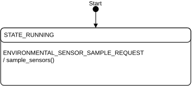

# Environmental module

The Environmental module collects sensor data from the onboard BME680 environmental sensor on the Thingy:91 X.
The module provides temperature, pressure, and humidity readings to other modules through the zbus messaging system. The module initializes the sensor hardware and responds to sampling requests from the main application module.

To initiate a sensor reading, the Main module sends an `ENVIRONMENTAL_SENSOR_SAMPLE_REQUEST` message to the Environmental module. The Environmental module then reads the sensor data and sends an `ENVIRONMENTAL_SENSOR_SAMPLE_RESPONSE` message with the collected data asynchronously.

## Architecture

The Environmental module implements a state machine with the following states and transitions:



## Messages

The Environmental module communicates through the zbus channel `environmental_chan`, using message types defined in `environmental.h`.

### Input messages

The module accepts the following input message:

- **ENVIRONMENTAL_SENSOR_SAMPLE_REQUEST**: Requests the module to take new sensor readings from the environmental sensor.

### Output messages

The module publishes the following output message:

- **ENVIRONMENTAL_SENSOR_SAMPLE_RESPONSE**: Returns collected environmental data with the following fields:

    - `temperature`: Temperature value in degrees Celsius.
    - `pressure`: Atmospheric pressure in Pascals.
    - `humidity`: Relative humidity percentage.

The message structure used by the Environmental module is defined in `environmental.h`:

```c
struct environmental_msg {
    enum environmental_msg_type type;
    double temperature;
    double pressure;
    double humidity;
};
```

## Configuration

You can configure the Environmental module with the following Kconfig options:

- **CONFIG_APP_ENVIRONMENTAL**: Enables the Environmental module.
- **CONFIG_APP_ENVIRONMENTAL_THREAD_STACK_SIZE**: Size of the stack for the Environmental module's thread.
- **CONFIG_APP_ENVIRONMENTAL_WATCHDOG_TIMEOUT_SECONDS**: Defines the watchdog timeout for the Environmental module.
- **CONFIG_APP_ENVIRONMENTAL_MSG_PROCESSING_TIMEOUT_SECONDS**: Maximum time allowed for processing a single message.
- **CONFIG_APP_ENVIRONMENTAL_LOG_LEVEL_INF**, **_ERR**, **_WRN**, and **_DBG**: Control the logging level for the Environmental module.

For more information about the Kconfig options, see the `Kconfig.environmental` file in the module's directory.
