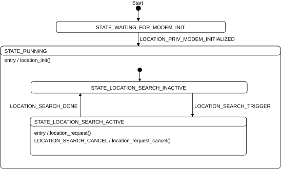

# Location module

The Location module manages location services using the [Location](https://docs.nordicsemi.com/bundle/ncs-latest/page/nrf/libraries/modem/location.html) library in the nRF Connect SDK. It handles Global Navigation Satellite System (GNSS) initialization and location requests, and it processes location events. The module uses Zephyr's [State Machine Framework](https://docs.zephyrproject.org/latest/services/smf/index.html) (SMF) and zbus for messaging with other modules.

The module performs the following tasks:

- Initializing and managing the Location library and the GNSS functionality.
- Handling location requests and processing location events.
- Managing the different location methods, which are GNSS, cellular, and Wi-Fi, and the fallback scenarios.
- Updating system time using GNSS time data when available.
- Publishing location status updates to other modules.

The Location module works together with the Network module, because the GNSS functionality can only be initialized after the modem is initialized and enabled.
It uses the Location library's event handler to process location-related events and publish status updates through the zbus messaging system.

The following sections cover the module's main messages, configuration options, and state machine.
For implementation details, see the `location.c`, `location.h`, and `Kconfig.location` source files.

## Architecture

The Location module implements a state machine with the following states and transitions:



## Messages

The Location module publishes and receives messages over the zbus channel `location_chan`. All module message types are defined in `location.h` and used within `location.c`.

### Input messages

The module accepts the following input messages:

- **LOCATION_SEARCH_TRIGGER**: Triggers a location search request. The module attempts to get the current location using the configured methods.
- **LOCATION_GNSS_SEARCH_TRIGGER**: Requests a GNSS-only fix, bypassing the Wi-Fi and cellular methods.
- **LOCATION_SEARCH_CANCEL**: Cancels an ongoing location search. For known limitations with Wi-Fi scanning, see `location.h`.

### Output messages

The module publishes the following output messages:

- **LOCATION_MODULE_READY**: Indicates that the Location module has finished initialization.
- **LOCATION_SEARCH_STARTED**: Indicates that a location search has been initiated.
- **LOCATION_SEARCH_DONE**: Indicates that a location search has completed, either successfully or with an error or a timeout.
- **LOCATION_GNSS_DATA**: Contains a successful GNSS fix.
- **LOCATION_CLOUD_REQUEST**: Contains cellular neighbor cell information, Wi-Fi access point information, or both, to send to the cloud services for location resolution.
- **LOCATION_AGNSS_REQUEST**: Indicates that assisted GNSS (A-GNSS) assistance data is needed for GNSS positioning.

The message types used by the Location module are defined in `location.h`:

```c
enum location_msg_type {
    LOCATION_SEARCH_STARTED = 0x1,
    LOCATION_SEARCH_DONE,
    LOCATION_CLOUD_REQUEST,
    LOCATION_AGNSS_REQUEST,
    LOCATION_GNSS_DATA,
    LOCATION_MODULE_READY,
    LOCATION_SEARCH_TRIGGER,
    LOCATION_GNSS_SEARCH_TRIGGER,
    LOCATION_SEARCH_CANCEL,
};
```

## Configuration

You can configure the Location module with the following Kconfig options from `Kconfig.location`:

- **CONFIG_APP_LOCATION**: Enables the Location module. The option is selected automatically when **CONFIG_LOCATION** is enabled.
- **CONFIG_APP_LOCATION_THREAD_STACK_SIZE**: Stack size for the Location module's main thread.
- **CONFIG_APP_LOCATION_WATCHDOG_TIMEOUT_SECONDS**: Watchdog timeout for the module's thread, 120 seconds by default.
  The timeout covers the following periods:

    - Waiting for an incoming message in `zbus_sub_wait_msg()`.
    - Time spent processing the message, defined by the **CONFIG_APP_LOCATION_MSG_PROCESSING_TIMEOUT_SECONDS** Kconfig option.

    This value must be larger than **CONFIG_APP_LOCATION_MSG_PROCESSING_TIMEOUT_SECONDS**.
    A small difference between the two can mean more frequent watchdog feeds, which increases power consumption.

- **CONFIG_APP_LOCATION_MSG_PROCESSING_TIMEOUT_SECONDS**: Maximum time allowed for processing a single message, 60 seconds by default.
  This value must be smaller than the value set in the **CONFIG_APP_LOCATION_WATCHDOG_TIMEOUT_SECONDS** Kconfig option.

For more information about these configuration options, see the `Kconfig.location` file.

## Location method priority

The following sections describe the default location method order, how the Location library combines Wi-Fi and cellular requests, and how to change the order.

### Default method order

The board configuration files `thingy91x_nrf9151_ns.conf` and `nrf9151dk_nrf9151_ns.conf` set the following default method priority order.

The Thingy:91 X uses the following order:

| Priority | Method | Kconfig option |
| --- | --- | --- |
| 1st | GNSS | `CONFIG_LOCATION_REQUEST_DEFAULT_METHOD_FIRST_GNSS` |
| 2nd | Wi-Fi | `CONFIG_LOCATION_REQUEST_DEFAULT_METHOD_SECOND_WIFI` |
| 3rd | Cellular | `CONFIG_LOCATION_REQUEST_DEFAULT_METHOD_THIRD_CELLULAR` |

The nRF9151 DK uses the following order:

| Priority | Method | Kconfig option |
| --- | --- | --- |
| 1st | GNSS | `CONFIG_LOCATION_REQUEST_DEFAULT_METHOD_FIRST_GNSS` |
| 2nd | Cellular | `CONFIG_LOCATION_REQUEST_DEFAULT_METHOD_SECOND_CELLULAR` |

For a description of each method's accuracy, latency, and power
characteristics, see the
[nRF Cloud Location Services overview](https://docs.nordicsemi.com/bundle/nrf-cloud/page/LocationServices/LSOverview.html).

### Wi-Fi and cellular combining

When the Wi-Fi and cellular methods are adjacent in the method list, the
Location library automatically combines them into a single
`LOCATION_METHOD_WIFI_CELLULAR` cloud request.

### Changing the method order

The following Kconfig options in the board configuration file or in `prj.conf`
control the method priority:

- `CONFIG_LOCATION_REQUEST_DEFAULT_METHOD_FIRST_*`
- `CONFIG_LOCATION_REQUEST_DEFAULT_METHOD_SECOND_*`
- `CONFIG_LOCATION_REQUEST_DEFAULT_METHOD_THIRD_*`

## nRF Cloud location service usage

nRF Cloud resolves the Wi-Fi and cellular location requests, including the combined
`LOCATION_METHOD_WIFI_CELLULAR` requests, and these requests
count toward the monthly location request quota. GNSS resolves the position
on the device and does not consume cloud requests.

The free Developer plan on nRF Cloud includes 1,500 location requests
per month. For the current plan limits, see the
[nRF Cloud pricing page](https://nrfcloud.com/pricing).
