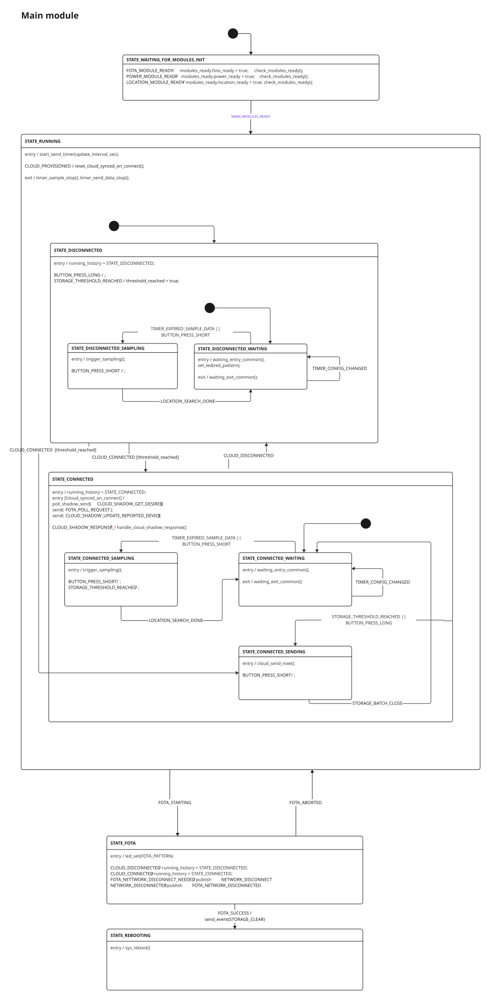

# Main module

The Main module serves as the central control unit of the Asset Tracker Template. It implements a hierarchical state machine that coordinates the activities of all other modules through [zbus](https://docs.nordicsemi.com/bundle/ncs-latest/page/zephyr/services/zbus/index.html) messages.
This module handles the application's business logic, including cloud connectivity, data sampling, firmware updates, configuration updates, and user interactions.

## Architecture

The Main module implements a state machine with the following states and transitions:

## Messages

The Main module does not implement messages available to other modules. Instead, it processes messages from other modules to control the application's behavior.
The module uses the following zbus channels, both for subscribing to incoming data and publishing outbound requests or status updates:

| Channel                | Description                                                                                |
|------------------------|--------------------------------------------------------------------------------------------|
| `button_chan`          | Process user button presses to trigger data samples or sending.                            |
| `cloud_chan`           | Receive connectivity status and cloud responses. Trigger device shadow polling.            |
| `storage_chan`         | Control the Storage module and receive status responses.                                   |
| `environmental_chan`   | Request sensor data from the Environmental module.                                         |
| `fota_chan`            | Trigger FOTA polls, and orchestrate network disconnect, storage cleanup, and reboot.       |
| `led_chan`             | Update LED patterns to indicate system state.                                              |
| `location_chan`        | Request new location data when samples are due.                                            |
| `network_chan`         | Control LTE network connection and track cellular connectivity events.                     |
| `power_chan`           | Request battery status and initiate low-power mode.                                        |
| `timer_chan`           | Handle timer events for sampling.                                                          |

## Firmware updates (FOTA)

The [FOTA module](fota_module.md) handles polling, downloading, and applying firmware images. The Main module subscribes to `fota_chan` and coordinates what happens around those steps while in `STATE_FOTA`.

When the FOTA module begins a download, it publishes `FOTA_STARTING`. The Main module responds by entering `STATE_FOTA` and shows a purple LED pattern for the duration of the download.

Before the device can reboot or apply a full modem image, the FOTA module may need LTE offline. It then publishes `FOTA_NETWORK_DISCONNECT_NEEDED`. The Main module disconnects through `network_chan` and, once the network is down, replies with `FOTA_NETWORK_DISCONNECTED` so the FOTA module can continue.

When the update is ready to take effect, the FOTA module publishes `FOTA_REQUEST_REBOOT`. The Main module clears buffered sample data by publishing `STORAGE_CLEAR` on `storage_chan`, then transitions to `STATE_REBOOTING`. Wiping storage before reboot avoids carrying stale or incompatible data into the new firmware.

If the update fails or is canceled, the FOTA module publishes `FOTA_ABORTED` and the Main module returns to the state it was in before the download started.

For operator steps, see [Firmware updates (FOTA)](../common/fota.md).

## LED status indicators

The Main module uses LED colors to indicate different device states:

- **Red** (blinking, 10 repetitions): The device is idle and disconnected from the cloud.
- **Blue** (blinking, 10 repetitions): The device is actively sampling data.
- **Green** (blinking, 10 repetitions): The device is sending data to the cloud.
- **Purple** (blinking): A FOTA download is in progress.

## Configuration

You can configure the Main module with the following Kconfig options:

- **CONFIG_APP_LOG_LEVEL**: Controls the logging level for the Main module.
- **CONFIG_APP_SAMPLING_INTERVAL_SECONDS**: Default sensor data sampling interval in buffer mode. Triggers sensor sampling and location search.
- **CONFIG_APP_MSG_PROCESSING_TIMEOUT_SECONDS**: Maximum time allowed for processing a single message.
- **CONFIG_APP_WATCHDOG_TIMEOUT_SECONDS**: Defines the watchdog timeout for the Main module.
