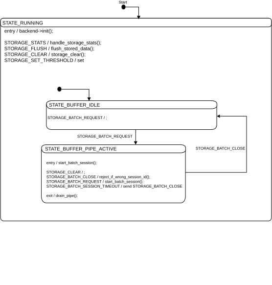

# Storage module

The Storage module forwards or stores data from enabled modules.

The module is implemented as a small state machine with a parent `RUNNING` state, using Zephyr's [State Machine Framework](https://docs.nordicsemi.com/bundle/ncs-latest/page/zephyr/services/smf/index.html) (SMF).
It discovers data types automatically through iterable sections.
For implementation details, see the `storage.c`, `storage.h`, and `Kconfig.storage` source files.

## Architecture

The following sections describe the module's state machine, its storage backends, the data flow, the batch session protocol, and its memory and flash use.

### State diagram

The Storage module implements a state machine with the following states and transitions:



The module implements the following states:

- **RUNNING** (parent): Initializes the backend and handles the `STORAGE_CLEAR`, `STORAGE_FLUSH`, `STORAGE_STATS`, and `STORAGE_SET_THRESHOLD` admin commands.
- **STATE_BUFFER_IDLE**: Stores incoming data and waits for commands. Transitions to `STATE_BUFFER_PIPE_ACTIVE` on `STORAGE_BATCH_REQUEST`.
- **STATE_BUFFER_PIPE_ACTIVE**: Actively serves batch data through the batch interface. Transitions back to `STATE_BUFFER_IDLE` when the batch session ends.

### Backend

Backends implement the API defined in the `app/src/modules/storage/storage_backend.h` file and provide the `init`, `store`, `peek`, `retrieve`, `count`, and `clear` operations.

The Storage module supports two backends.

#### RAM backend

The RAM backend is the default backend and has the following properties:

- **Characteristics**: Fast in-memory storage.
- **Data persistence**: Data is lost on power loss or device reset.
- **Use case**: Applications that can tolerate data loss.

#### LittleFS flash backend

The LittleFS flash backend has the following properties:

- **Characteristics**: Persistent flash-based storage using the LittleFS filesystem.
- **Data persistence**: Data survives power loss and device resets.
- **Use case**: Applications that need data durability and persistence across power cycles.

### Data flow

Data producing modules publish sampled data to their respective zbus channel.
The module stores the data and later emits it with a flush, or streams it over the batch pipe using the batch interface described in the following section.

### Batch session protocol

Batch reads use a consume-on-confirm contract, so that the module only removes an item
from the backend after the consumer has confirmed that it processed the item, for example
by sending it to the cloud successfully. A typical session runs as follows:

1. The consumer publishes `STORAGE_BATCH_REQUEST` with a non-zero `session_id`.
1. The Storage module responds with `STORAGE_BATCH_AVAILABLE`, with `data_len` set to the
   number of items available, and primes the pipe with the head item.
   If there is no data, it sends `STORAGE_BATCH_EMPTY`, and you must still close the session.
1. The consumer calls `storage_batch_read()` to read the head item. This call does **not** remove the item from the backend.
1. After processing the item, the consumer publishes
   `STORAGE_BATCH_CONSUME` with the matching `session_id` and the `data_type`
   of the item. The Storage module removes the head item and primes the next one in the
   pipe.
1. Steps 3 and 4 repeat until `storage_batch_read()` returns `-ENODATA`,
   or until the consumer decides to stop.
1. The consumer publishes `STORAGE_BATCH_CLOSE` to end the session.

If the consumer reads without consuming, `storage_batch_read()` repeatedly
returns the same head item. If a `STORAGE_BATCH_CONSUME` arrives with an
unknown or mismatched `data_type`, the Storage module aborts the session with
`STORAGE_BATCH_ERROR` to avoid silent stalls.

### Memory management

The module allocates RAM from the following places, which you can tune individually:

- Built-in batch pipe buffer: `CONFIG_APP_STORAGE_BATCH_BUFFER_SIZE` bytes are reserved at boot.
- RAM backend ring buffers: For each enabled data type, a ring buffer is declared with capacity `sizeof(type) * CONFIG_APP_STORAGE_MAX_RECORDS_PER_TYPE`.
- Message buffers: `struct storage_msg` carries a `buffer[STORAGE_MAX_DATA_SIZE]`, where `STORAGE_MAX_DATA_SIZE` is the max size of any enabled data type.
  Enabling large types increases this buffer and several temporary buffers.
- Subscriber queue: Size is controlled by system zbus configuration.
- Thread stack: `CONFIG_APP_STORAGE_THREAD_STACK_SIZE`.

#### How to reduce RAM

To lower the module's RAM use, apply any of the following measures:

- **Minimize the enabled data types**: Disable the modules whose data you do not forward or store, for example with `CONFIG_APP_LOCATION=n`.
  This reduces both the slabs and the RAM backend ring buffers, and it shrinks `STORAGE_MAX_DATA_SIZE`.
- **Reduce the records per type**: Set `CONFIG_APP_STORAGE_MAX_RECORDS_PER_TYPE=1` when you do not need buffering.
  This shrinks both the per-type slabs and the RAM ring buffers to a single record each.
- **Shrink the batch pipe buffer**: Set the `CONFIG_APP_STORAGE_BATCH_BUFFER_SIZE` Kconfig option to a lower value, for example from 1024 down to 256 bytes.
  If you use batch mode, make sure the buffer can still hold at least one item of `sizeof(header) + max_item_size`.
- **Reduce the thread stack and the queues**: Set the `CONFIG_APP_STORAGE_THREAD_STACK_SIZE` Kconfig option to a lower value, for example from 2048 down to 1024, if your application leaves headroom.
  You can also reduce the relevant zbus queue sizes in the system configuration if the traffic allows it.
- **Remove the development features**: Disable the `CONFIG_APP_STORAGE_SHELL` and `CONFIG_APP_STORAGE_SHELL_STATS` Kconfig options to trim the RAM and code footprint.
- **Prefer the LittleFS backend when buffering many records**: Use the LittleFS backend when you need a large `CONFIG_APP_STORAGE_MAX_RECORDS_PER_TYPE` value, because the RAM backend allocates all ring buffers at boot, while the LittleFS backend only uses RAM for the records that are currently stored.
- **Use the ready-made Kconfig fragment**: Use `overlay-storage-minimal.conf` to apply a minimal storage configuration with reduced RAM usage.

#### Minimal RAM example

If your application only needs immediate sending (`CONFIG_APP_STORAGE_INITIAL_THRESHOLD=1`), the following `prj.conf` excerpt minimizes RAM usage for the Storage module.

```config
# Minimal storage configuration
CONFIG_APP_STORAGE=y
CONFIG_APP_STORAGE_BACKEND_RAM=y

# Keep only a single slot per type (no buffering planned)
CONFIG_APP_STORAGE_MAX_RECORDS_PER_TYPE=1
# Send a message for every sample
CONFIG_APP_STORAGE_INITIAL_THRESHOLD=1

# Drop development features
CONFIG_APP_STORAGE_SHELL=n
CONFIG_APP_STORAGE_SHELL_STATS=n
```

> [!NOTE]
> For the RAM backend, the actual RAM consumed by the ring buffers scales with which data types are enabled and the value of the `CONFIG_APP_STORAGE_MAX_RECORDS_PER_TYPE` Kconfig option.

### Flash management (LittleFS backend)

#### Partition sizing

You must configure the partition size for the LittleFS backend to accommodate the data types in use, their sizes, and the number of records per type. The backend needs a minimum partition size to operate correctly.

Calculate the needed size as follows:

- Per-type block need:

```math
\text{blocks per type} = \left\lceil \frac{\text{data size} \times \text{records per type}}{\text{block size}} \right\rceil
```

- Total required blocks:

```math
\text{required blocks} = \sum \text{blocks per type} + 3
```

where the `+3` accounts for LittleFS metadata and the CoW block.

- Minimum partition size:

```math
\text{flash size} = \text{required blocks} \times \text{block size}
```

Choose a partition size that meets or exceeds `flash_size`. The LittleFS partition size is set by the `littlefs_storage` node in [`app/boards/att_flash_partitions.dtsi`](https://github.com/nrfconnect/Asset-Tracker-Template/blob/main/app/boards/att_flash_partitions.dtsi), which both board overlays include:

```devicetree
littlefs_storage: partition@4d2000 {
    label = "littlefs_storage";
    reg = <0x004d2000 0x00100000>;   /* 1 MiB */
};
```

The second `reg` cell, `0x00100000` in this example, is the partition size in bytes. To make the partition larger, raise that value and shrink the adjacent `external_flash_partition` by the same amount, so the 32 MiB external flash layout stays consistent.

If the partition does not meet the requirement, either grow it in `att_flash_partitions.dtsi` as shown in the preceding snippet, or reduce the storage pressure by using fewer records, smaller data types, or fewer enabled types.

> [!NOTE]
> The data types are stored in separate files, so the minimum number of flash blocks needed is ∑ data types + 3.

#### Target-specific defaults

The block size comes from the mounted filesystem through `fs_statvfs()`. On the template's targets, the filesystem uses external SPI-NOR with `CONFIG_SPI_NOR_FLASH_LAYOUT_PAGE_SIZE=4096`, which is `0x1000`.
The following table illustrates the minimal sizing for a small configuration of three data types with eight records per type.
The shipped default is 1 MiB with up to 256 records per type, which needs far more blocks.
To size that configuration, use the preceding formula, or read the `LittleFS partition size verified` log line that the LittleFS backend writes when it checks the sizing at initialization.

| Target | Block size | Example blocks needed | Example minimal partition |
| - | - | - | - |
| nRF9151 DK and Thingy:91 X, external SPI-NOR | 0x1000 (4096 B) | 8 + 3 metadata | 0x2c000 (~176 KiB) |
| Internal flash, not recommended | 0x1000 | 8 + 3 metadata | 0x2c000 |

The default 1 MiB partition, `0x00100000`, on both boards leaves ample margin for all enabled data types at `CONFIG_APP_STORAGE_MAX_RECORDS_PER_TYPE=256`.

#### LittleFS built-in wear leveling

LittleFS provides inherent wear leveling at the filesystem level:

- LittleFS automatically distributes writes across available flash blocks, avoiding repeated writes to the same physical location.
- Filesystem metadata is spread across the partition, preventing hotspots on metadata blocks.
- Updates are written to new blocks rather than overwriting existing data, naturally distributing erase cycles.
- As blocks become dirty, LittleFS reclaims and redistributes them, ensuring uniform wear across the entire partition.
- The filesystem tracks block usage patterns and preferentially allocates less-worn blocks for new writes.

#### Application-level ring buffer wear leveling

The Storage module adds an additional wear leveling layer through its ring buffer architecture.

##### Block-level distribution

- Entries are distributed across files matched to flash blocks.
- Each data type has its own file, preventing cross-type interference.
- Writes cycle through all available record slots before overwriting.
- Rewrites only modify the affected flash blocks, minimizing unnecessary writes.

#### Combined wear protection

The combination of LittleFS wear leveling and the ring buffer architecture provides the following protection:

- **Temporal distribution**: The ring buffer spreads writes over time across the record slots.
- **Spatial distribution**: LittleFS spreads those writes across the physical flash blocks.
- **Type isolation**: Each data type has its own write pattern, which prevents interference.
- **Automatic wear balancing**: The mechanism works transparently and needs no configuration.

#### Minimizing flash wear

To optimize the flash lifespan further, apply any of the following measures:

- **Increase the partition size**: Larger partitions provide more blocks for write distribution.
- **Increase the record count**: A higher `CONFIG_APP_STORAGE_MAX_RECORDS_PER_TYPE` value reduces the rewrite frequency.
- **Use the RAM backend when possible**: If data persistence is not critical, use the RAM backend to avoid flash writes entirely.

#### Configuration examples

The following sections showcase various configuration examples.

##### Basic LittleFS configuration

To enable persistent flash storage, use the following configuration:

```config
CONFIG_APP_STORAGE=y
CONFIG_APP_STORAGE_BACKEND_LITTLEFS=y

# Adjust for your needs
CONFIG_APP_STORAGE_MAX_RECORDS_PER_TYPE=16
CONFIG_APP_STORAGE_THREAD_STACK_SIZE=4000
```

You configure the partition size in devicetree, as described in [Partition sizing](#partition-sizing). The default `littlefs_storage` partition is 1 MiB on both the Thingy:91 X and the nRF9151 DK.

##### Optimized for data persistence with minimal flash wear

The following configuration reduces the rewrite frequency by storing more records per type:

```config
# Storage enabled with persistent backend
CONFIG_APP_STORAGE=y
CONFIG_APP_STORAGE_BACKEND_LITTLEFS=y

# Higher record count reduces rewrite frequency
CONFIG_APP_STORAGE_MAX_RECORDS_PER_TYPE=50
```

To improve wear leveling further, grow the `littlefs_storage` partition in `att_flash_partitions.dtsi`, so the writes are spread across more flash blocks. For the exact devicetree snippet to edit, see [Partition sizing](#partition-sizing).

## Messages

The Storage module communicates through two zbus channels: `storage_chan` and `storage_data_chan`.
All message types are defined in the `storage.h` file.

### Input messages

The parent `RUNNING` state handles the following data operation messages:

- **STORAGE_SET_THRESHOLD**: Set the threshold for triggering `STORAGE_THRESHOLD_REACHED`.
  If the threshold is `1`, every sample triggers a message. Higher values enable buffering until the module reaches the threshold.
- **STORAGE_FLUSH**: Flushes stored data one item at a time as individual `STORAGE_DATA` messages.
  The module sends the data in FIFO order per type. This message is available in both operational modes.
- **STORAGE_BATCH_REQUEST**: Requests access to stored data through the batch interface.
  The module responds with `STORAGE_BATCH_AVAILABLE`, `STORAGE_BATCH_EMPTY`, `STORAGE_BATCH_BUSY`, or `STORAGE_BATCH_ERROR`.
  This message is available in both operational modes.
- **STORAGE_BATCH_CONSUME**: Confirms that the consumer has processed the head item of an active batch session,
  for example by sending it to the cloud successfully. The `session_id` must match the
  active session, and `data_type` must identify the type of the item just read with
  `storage_batch_read()`. The module removes the item from the backend and makes the next item
  available in the pipe. An unknown or mismatched `data_type` aborts the session.
- **STORAGE_BATCH_CLOSE**: Ends a batch session. You must send this message for every session, including
  sessions that received `STORAGE_BATCH_EMPTY` or `STORAGE_BATCH_ERROR`.
- **STORAGE_CLEAR**: Clears all stored data from the backend.
  This message is available in both operational modes.

The parent `RUNNING` state also handles the following diagnostics message:

- **STORAGE_STATS**: Requests storage statistics, which needs `CONFIG_APP_STORAGE_SHELL_STATS`.
  The module logs the statistics to the console.
  This message is available in both operational modes.

### Output messages

The module publishes the following data event message:

- **STORAGE_THRESHOLD_REACHED**: Emitted when the number of stored samples for a type reaches the configured threshold.
  Contains the data type and the count that triggered the event.

The module publishes the following data message:

- **STORAGE_DATA**: Contains the stored data that the module flushes or forwards.
  Includes the data type and the data payload itself.

The module publishes the following batch status messages:

- **STORAGE_BATCH_AVAILABLE**: The batch is ready for reading.
  The message includes the total item count available and the session ID.
- **STORAGE_BATCH_EMPTY**: No stored data is available, which means that the batch is empty.
- **STORAGE_BATCH_BUSY**: Another module is using the batch session.
- **STORAGE_BATCH_ERROR**: An error occurred during a batch operation.

### Message structure

The message structure used by the Storage module is defined in `storage.h`:

```c
struct storage_msg {
    enum storage_msg_type type;           /* Message type */
    enum storage_data_type data_type;     /* Data type for STORAGE_DATA / STORAGE_BATCH_CONSUME */
    union {
        uint8_t buffer[STORAGE_MAX_DATA_SIZE];
        uint32_t session_id;              /* Batch session id */
    };
    uint32_t data_len;                    /* Length or count */
};
```

## Configuration

You can configure the Storage module with the Kconfig options in `Kconfig.storage`.
The following sections cover the key configuration categories.

### Storage backend

The following options select the storage backend:

- **CONFIG_APP_STORAGE_BACKEND_RAM** (default): Uses RAM for storage.
  Access is fast, but the data is lost on a power cycle.
- **CONFIG_APP_STORAGE_BACKEND_LITTLEFS**: Uses the LittleFS filesystem for flash storage.
  The data is persistent across power cycles, but access is slower.

### Memory configuration

The following options control the module's memory use:

- **CONFIG_APP_STORAGE_MAX_TYPES** (default: `3`): Maximum number of different data types that you can register.
  This option affects the RAM usage.
- **CONFIG_APP_STORAGE_MAX_RECORDS_PER_TYPE** (default: `8` for the RAM backend, `256` for the LittleFS backend): Maximum records stored per data type.
  The total RAM usage is `MAX_TYPES` × `MAX_RECORDS_PER_TYPE` × `RECORD_SIZE`.
- **CONFIG_APP_STORAGE_BATCH_BUFFER_SIZE** (default: `512`): Size of the internal buffer for batch data access.

### Flash configuration (LittleFS backend)

The `littlefs_storage` partition (size and host flash chip) is defined in devicetree. [`app/boards/att_flash_partitions.dtsi`](https://github.com/nrfconnect/Asset-Tracker-Template/blob/main/app/boards/att_flash_partitions.dtsi) declares the partition on external SPI-NOR and the `lfs1` `zephyr,fstab,littlefs` entry (mount point `/att_storage`, automount). Board overlays [`thingy91x_nrf9151_ns.overlay`](https://github.com/nrfconnect/Asset-Tracker-Template/blob/main/app/boards/thingy91x_nrf9151_ns.overlay) and [`nrf9151dk_nrf9151_ns.overlay`](https://github.com/nrfconnect/Asset-Tracker-Template/blob/main/app/boards/nrf9151dk_nrf9151_ns.overlay) include that file.

To resize the partition, edit the second `reg` cell of `littlefs_storage` in `att_flash_partitions.dtsi`, and shrink `external_flash_partition` by the same amount. To move the partition to internal flash, declare a `littlefs_storage` node under the `partitions` node of `&flash0` instead. The 1 MiB internal flash of the nRF9151 is already used heavily by `slot0_partition`, so use external flash for any non-trivial storage size.

### Threshold configuration

The following option controls the buffering threshold:

- **CONFIG_APP_STORAGE_INITIAL_THRESHOLD** (default: `1`): Initial threshold for triggering `STORAGE_THRESHOLD_REACHED` events.
  A value of `1` means that every sample triggers an event, while higher values enable buffering until the module reaches the threshold.
  You can change the threshold at runtime through `STORAGE_SET_THRESHOLD` messages.

### Thread configuration

The following options control the module's thread:

- **CONFIG_APP_STORAGE_THREAD_STACK_SIZE** (default: `2048` for the RAM backend, `4000` for the LittleFS backend): Stack size for the Storage module's main thread.
- **CONFIG_APP_STORAGE_WATCHDOG_TIMEOUT_SECONDS** (default: `60`): Watchdog timeout for detecting stuck operations.
- **CONFIG_APP_STORAGE_MSG_PROCESSING_TIMEOUT_SECONDS** (default: `5`): Maximum time for processing a single message.

### Development features

The following options enable the development features:

- **CONFIG_APP_STORAGE_SHELL** (default: `y`): Enables the shell commands for storage interaction.
- **CONFIG_APP_STORAGE_SHELL_STATS**: Enables the statistics commands, which increases the code size.

### Message handling

The states handle the messages as follows:

- **RUNNING state**: Handles the `STORAGE_CLEAR`, `STORAGE_FLUSH`, `STORAGE_STATS`, and `STORAGE_SET_THRESHOLD` messages.
- **BUFFER_IDLE state**: Handles `STORAGE_BATCH_REQUEST` to transition to `BUFFER_PIPE_ACTIVE`.
- **BUFFER_PIPE_ACTIVE state**: Populates the pipe with `[header + data]` items and handles the session management.

## API documentation

The following sections describe the module's zbus channels, its data type registration, the backend interface, and the batch read helper.

### Channels

The module defines two zbus channels.

#### Storage channel

The `storage_chan` channel is the primary zbus channel for controlling the Storage module and receiving control or status responses.

The channel carries the following input message types:

- `STORAGE_SET_THRESHOLD`: Set the threshold for `STORAGE_THRESHOLD_REACHED` events.
- `STORAGE_FLUSH`: Flush the stored data as individual messages.
- `STORAGE_BATCH_REQUEST`: Request batch access to the stored data.
- `STORAGE_CLEAR`: Clear all stored data.
- `STORAGE_STATS`: Display the storage statistics.

The channel carries the following output message types:

- `STORAGE_THRESHOLD_REACHED`: The module reached the threshold for a data type.
- `STORAGE_BATCH_AVAILABLE`: The batch is ready with data.
- `STORAGE_BATCH_EMPTY`: No data is available.
- `STORAGE_BATCH_BUSY`: Another session is active.
- `STORAGE_BATCH_ERROR`: An error occurred while accessing the data.

#### Storage data channel

The `storage_data_chan` channel is a dedicated channel for `STORAGE_DATA` payload messages, which avoids self-flooding and race conditions.
Subscribers that are interested in data observe this channel.

The channel carries the following output message type:

- `STORAGE_DATA`: Contains stored or forwarded data.

### Data type registration

The module registers data types automatically with the `DATA_SOURCE_LIST` macro in `storage_data_types.h`. The template supports the following data types:

- **Battery** (`CONFIG_APP_POWER`): Stores a `double` from `POWER_BATTERY_PERCENTAGE_SAMPLE_RESPONSE`.
- **Location** (`CONFIG_APP_LOCATION`): Stores a `struct location_msg` from `LOCATION_GNSS_DATA` or `LOCATION_CLOUD_REQUEST`.
- **Environmental** (`CONFIG_APP_ENVIRONMENTAL`): Stores a `struct environmental_msg` from `ENVIRONMENTAL_SENSOR_SAMPLE_RESPONSE`.

Each data type registration includes the following items:

- The source channel to subscribe to.
- The message type filtering function.
- The data extraction function.
- The storage data type identifier.

### Backend interface

Storage backends implement the interface defined in the `app/src/modules/storage/storage_backend.h` file:

```c
struct storage_backend {
    int (*init)(void);
    int (*store)(const struct storage_data *type, void *data, size_t size);
    int (*peek)(const struct storage_data *type, void *data, size_t size);
    int (*retrieve)(const struct storage_data *type, void *data, size_t size);
    int (*count)(const struct storage_data *type);
    int (*clear)(void);
};
```

### Batch read helper

The Storage module provides a convenience function for reading batch data:

```c
int storage_batch_read(struct storage_data_item *out_item, k_timeout_t timeout);
```

The function reads stored data through the batch interface, handling the header parsing and the data extraction automatically. All other operations go through zbus messages, including requesting batch access and session management.

The function returns `0` on a successful read, `-ENODATA` when it reaches the
end-of-batch marker and the session has consumed all items, `-EAGAIN` if no data
becomes available within `timeout`, or another negative `errno` on error.

> [!NOTE]
> Call this function only after receiving a `STORAGE_BATCH_AVAILABLE` message in response to a `STORAGE_BATCH_REQUEST`.
> When you have consumed all items, send `STORAGE_BATCH_CLOSE` with the same `session_id`.

## Usage

The following sections describe how to retrieve stored data, process `STORAGE_DATA` messages, issue admin commands, and use the shell commands.

### Data retrieval

The module offers two ways to retrieve the stored data.

The `STORAGE_FLUSH` message emits individual `STORAGE_DATA` messages. Use it for small datasets.

For bulk access, use `STORAGE_BATCH_REQUEST` with a unique `session_id`, as in the following example:

```c
struct storage_msg msg = { .type = STORAGE_BATCH_REQUEST, .session_id = 0x12345678 };

err = zbus_chan_pub(&storage_chan, &msg, K_SECONDS(1));

// Wait for STORAGE_BATCH_AVAILABLE, then:
struct storage_data_item item;
while (storage_batch_read(&item, K_SECONDS(1)) == 0) {
    switch (item.type) {
    case STORAGE_TYPE_BATTERY:
        double battery = item.data.BATTERY;
        break;
    // ... handle other types
    }
}

// Close session
struct storage_msg close = { .type = STORAGE_BATCH_CLOSE, .session_id = 0x12345678 };
zbus_chan_pub(&storage_chan, &close, K_SECONDS(1));
```

The module responds with `STORAGE_BATCH_AVAILABLE` on success, or with `STORAGE_BATCH_EMPTY`, `STORAGE_BATCH_BUSY`, or `STORAGE_BATCH_ERROR`.

### Processing `STORAGE_DATA`

Subscribe to `storage_data_chan` to receive the forwarded or flushed data, as in the following example:

```c
switch (msg->data_type) {
case STORAGE_TYPE_BATTERY:
    double *battery = (double *)msg->buffer;

    break;
case STORAGE_TYPE_LOCATION:
    struct location_msg *loc = (struct location_msg *)msg->buffer;

    break;
/* ... other types */
}
```

### Admin commands

The following example clears the stored data and then requests the storage statistics:

```c
/* Clear all stored data */
struct storage_msg msg = { .type = STORAGE_CLEAR };

err = zbus_chan_pub(&storage_chan, &msg, K_SECONDS(1));

/* Show statistics (requires CONFIG_APP_STORAGE_SHELL_STATS) */
struct storage_msg msg = { .type = STORAGE_STATS };

err = zbus_chan_pub(&storage_chan, &msg, K_SECONDS(1));
```

### Shell commands

When `CONFIG_APP_STORAGE_SHELL` is enabled, the following shell commands are available:

```bash
att_storage flush              # Flush stored data
att_storage clear              # Clear all data
att_storage stats              # Show statistics (requires CONFIG_APP_STORAGE_SHELL_STATS)
```

## Adding backends

To add a storage backend, complete the following steps:

1. Implement `struct storage_backend` as defined in `storage_backend.h`.
1. Provide the `storage_backend_get()` function.
1. Add a Kconfig option in `Kconfig.storage`.

For reference, see `backends/ram_ring_buffer_backend.c`.

## Dependencies

The Storage module depends on the following components:

- **Zephyr kernel**: Core OS functionality.
- **zbus messaging system**: Inter-module communication.
- **State Machine Framework (SMF)**: State management.
- **Task watchdog**: System reliability monitoring.
- **Memory slab allocator**: FIFO memory management.
- **Selected storage backend**: RAM or flash storage.
- **Iterable sections**: Automatic data type discovery.
